# PARTE 1: RELEVAMIENTO Y PROPUESTA

> Capítulo de la tesis correspondiente a la PP2. Base: `PP2_Moran_Fakiani` (mayo de 2026),
> con las observaciones del docente incorporadas. Las figuras están en `figuras/` y su
> listado en `figuras/INDICE.md`. El formato final (carátula, índices, membrete, paginación)
> se aplica al armar el documento Word.

# 1. Introducción

## 1.1. Carta de Presentación

*El Calafate, mayo de 2026*

A la Dirección de
Hotel Blanca Patagonia S.A.S.
Charles Furh 149, El Calafate, Santa Cruz
Presente.-

De nuestra mayor consideración:

Por medio de la presente, los alumnos Morán Santiago (DNI 45.693.596) y Fakiani Octavio
(DNI 44.970.369), estudiantes de la carrera Analista de Sistemas del Colegio Universitario
IES Siglo 21, nos dirigimos a ustedes para presentarnos como equipo de desarrollo a cargo del
proyecto de tesis «Sistema de Gestión de Hotelería».

El objetivo de este trabajo es relevar, analizar y diseñar un sistema informático integral
que acompañe y mejore los procesos actuales de gestión de reservas, estadías, facturación y
reportes del hotel. A lo largo del proyecto trabajaremos en contacto con el personal del
establecimiento para garantizar que la solución propuesta se ajuste a las necesidades reales
de la organización.

Agradecemos desde ya la confianza depositada en nuestro equipo y quedamos a disposición para
cualquier consulta.

Atentamente,

**Morán Santiago — Fakiani Octavio**
Estudiantes de Analista de Sistemas

## 1.2. Pedido del Usuario

El Hotel Blanca Patagonia, representado por su director Franco Theo Cheli, solicita
formalmente al grupo de análisis el relevamiento, diseño e implementación de un Sistema
Integral de Gestión Hotelera que comprenda los siguientes módulos:

- Gestión de reservas y estadías (realizar, consultar y cancelar reservas en línea).
- Check-in / check-out con facturación.
- Registro de consumos y servicios adicionales.
- Gestión de huéspedes.
- Reportes de ocupación y facturación.

El sistema deberá integrarse con la pasarela de pagos para cobros con tarjeta y con el
servicio de notificaciones por correo electrónico. Deberá ser accesible desde cualquier
dispositivo con conexión a internet, reemplazando las planillas de cálculo y el sistema
Winpax actualmente en uso.

### Firmas y conformidades

| Comitente / Responsable del hotel | Equipo de proyecto |
|---|---|
| Blanca Patagonia S.A.S. | Morán Santiago — DNI 45.693.596 |
| CUIT: 30-71845915-6 | Fakiani Octavio — DNI 44.970.369 |
| Director: Franco Theo Cheli | |
| DNI: 44.695.595 | |
| CUIL: 20-44.695.595-1 | |

<!-- docx: bloque de firmas. Izquierda: imagen figuras/anexos/firma-comitente-recorte.png sobre la
     línea «Franco Theo Cheli — Director, Blanca Patagonia S.A.S.». Derecha: dos líneas de
     firma en blanco, «Morán Santiago — DNI 45.693.596» y «Fakiani Octavio — DNI 44.970.369». -->

**Firma del comitente:** ver Anexo C.

# 2. Relevamiento

## 2.1. Contextual y del Negocio

### Datos de la empresa

| | |
|---|---|
| **Razón social** | Blanca Patagonia S.A.S. |
| **CUIT** | 30-71845915-6 |
| **Nombre de fantasía** | Blanca Patagonia |
| **Rubro** | Hotelería · Turismo · Gastronomía |
| **Categoría** | Hostería boutique 4 estrellas + complejo de cabañas |
| **Dirección** | Charles Furh 149, El Calafate, Santa Cruz, Argentina |
| **Teléfono** | +54 (2902) 493370 |
| **Correo electrónico** | blancapatagonia@cotecal.com.ar |
| **Sitio web** | www.blancapatagonia.com |

El hotel se ubica en el centro de El Calafate, a pocas cuadras del Lago Argentino y a
aproximadamente 80 km del Glaciar Perito Moreno. La ciudad es el principal punto de acceso al
Parque Nacional Los Glaciares, declarado Patrimonio de la Humanidad por la UNESCO.

**Distribución de espacios físicos**

- **Hostería boutique:** habitaciones Single, Doble Standard, Doble Superior, Triple y Suite
  Principal. Todas con vista al Lago Argentino e hidromasaje.
- **Complejo de cabañas:** unidades de 1, 2 y 3 dormitorios con capacidad de hasta 7 personas.
- **Recepción / lobby:** área de atención al huésped, check-in / check-out y oficina
  administrativa.
- **Restaurante:** servicio de desayuno buffet incluido en la tarifa; menú a la carta para
  almuerzo y cena.
- **Área de excursiones:** coordinación de traslados y contratación de excursiones al Parque
  Nacional Los Glaciares.

### Historia de la empresa

El Hotel Blanca Patagonia nació como un proyecto de alojamiento boutique orientado al turismo
de alto valor en El Calafate, ciudad que creció exponencialmente desde la apertura del
Aeropuerto Internacional en el año 2000.

| Período | Hito | Descripción |
|---|---|---|
| 2000–2005 | Fundación | Apertura de la hostería boutique con capacidad reducida. Primeras habitaciones Standard y Superior. |
| 2005–2010 | Crecimiento | Incorporación de suites e hidromasaje. Inicio de paquetes turísticos con operadoras del Parque Nacional Los Glaciares. |
| 2010–2015 | Cabañas | Desarrollo del complejo de cabañas. Captación del segmento familiar y corporativo. |
| 2015–2020 | Digital parcial | Implementación de Winpax, planillas de Excel y canales de venta informales. |
| 2020–2024 | Pandemia | Impacto del COVID-19. Reconversión hacia turismo nacional premium. Recuperación desde 2022. |
| 2025–2026 | Modernización | Inicio del proyecto de sistema integral. Objetivo: eliminar procesos manuales. |

### Mercado

**Productos y servicios comercializados**

| Línea | Producto | Descripción | Precio aproximado |
|---|---|---|---|
| Alojamiento | Single / Doble Standard | Vista al lago, desayuno incluido | USD 120–177 |
| Alojamiento | Doble Superior | Vista panorámica, hidromasaje | USD 139–195 |
| Alojamiento | Suite Principal | Piso alto, vista de 180° al lago | USD 190–225 |
| Cabañas | 1 a 3 dormitorios | Hasta 7 personas, equipamiento completo | USD 130–340 |
| Paquetes | Perito Moreno | Alojamiento + traslado + entrada al parque | Desde USD 320 |
| Paquetes | Todo Glaciares | Paquete de 4 noches + excursiones | Desde USD 750 |
| Gastronomía | Restaurante | Desayuno incluido. Menú a la carta | Variable |
| Adicionales | Excursiones | Navegación Upsala, Spegazzini, traslados | USD 75–220 |

**Distribución de reservas por canal** (datos reales de marzo de 2026)

| Canal | Participación |
|---|---|
| Booking.com | 66 % |
| Expedia | 13 % |
| Particular (reservas directas) | 21 % |

**Principales competidores en El Calafate**

- Hotel Posada Los Álamos (5 estrellas, segmento ultra-premium).
- Design Suites Calafate (4 estrellas boutique, competidor directo).
- Los Sueños de Calafate (3–4 estrellas, propuesta familiar).
- Plataformas de reserva en línea (Booking, Airbnb, Expedia), que afectan la tasa de
  ocupación directa.

### Dimensionamiento

Los siguientes datos surgen del informe gerencial de marzo de 2026 proporcionado por la
administración del hotel (Anexo B).

| Indicador | Dato | Observación |
|---|---|---|
| Habitaciones de la hostería | ~20 unidades | Single, Doble Standard, Doble Superior, Triple, Suite |
| Cabañas | 8–12 unidades | 1, 2 y 3 dormitorios |
| Pernoctes (marzo 2026) | 1.175 | Dato real del informe gerencial |
| Habitaciones ocupadas | 530 | Dato real de marzo de 2026 |
| Ocupación promedio | 86 % | Temporada alta |
| Tarifa promedio | USD 131 | Precio promedio por noche vendida |
| Pick-up mensual | 351 reservas | USD 132.479 en el mes |
| Ventas del restaurante | $ 11.923.925 | Ingreso gastronómico mensual |
| Ingresos totales | USD 88.052 | $ 123.273.529 (tipo de cambio 1.400) |
| Comisión de Booking | $ 13.260.237 | 10,76 % de los ingresos totales |
| Comisión de Expedia | $ 392.596 | 0,32 % de los ingresos totales |
| Reputación en Booking | 8,8 / 10 | Google: 4,3 / 5 · Expedia: 8,8 / 10 |

## 2.2. Estructura de la Organización

El hotel opera con una estructura funcional reducida, típica de una PyME hotelera del interior
del país. La dirección está a cargo de Franco Theo Cheli, quien supervisa las áreas operativas.

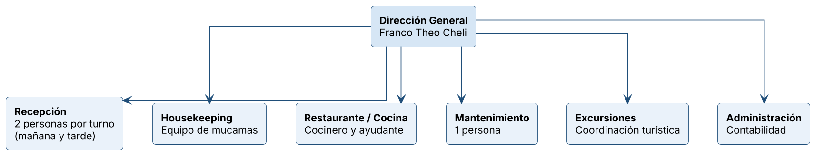

**Figura 1.** Organigrama funcional del Hotel Blanca Patagonia (2026). Fuente: elaboración propia.

**Descripción de las áreas**

- **Recepción.** Es el área central del hotel. Recibe a los huéspedes, gestiona las reservas
  (actualmente con Winpax y planillas), realiza el check-in y el check-out y coordina con las
  demás áreas. Funciona en dos turnos, con dos personas por turno.
- **Housekeeping.** Se encarga de la limpieza y preparación de las habitaciones. El costo
  promedio es de $ 1.257 por habitación ocupada.
- **Restaurante / cocina.** Ofrece desayuno buffet (incluido en la tarifa) y menú a la carta.
  El costo del desayuno es de $ 3.333 por persona. Genera un ingreso mensual de $ 11.923.925.
- **Mantenimiento.** Se encarga de las reparaciones y la conservación del edificio. El costo
  promedio es de $ 5.454 por habitación.
- **Excursiones.** Coordina los traslados y la contratación de excursiones.
- **Administración.** Gestiona la facturación, los pagos a proveedores, las comisiones de las
  agencias en línea y los reportes gerenciales.

## 2.3. Procesos de Negocio

A continuación se describen los principales procesos operativos del hotel tal como funcionan
actualmente, antes de la implementación del nuevo sistema. Cada proceso se presenta con su
cursograma, su descripción y los problemas detectados.

### 2.3.1. Proceso de reserva (actual)

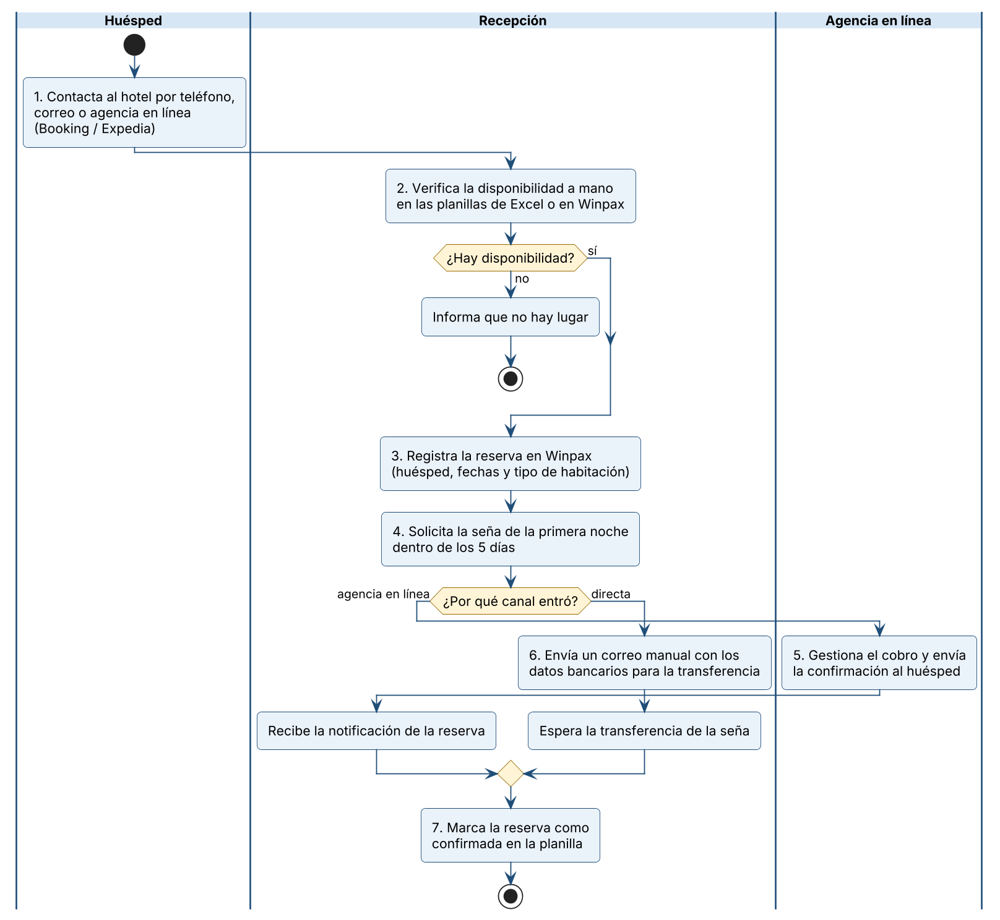

**Figura 2.** Cursograma del proceso de reserva actual (2026). Fuente: elaboración propia.

**Descripción**

1. El huésped contacta al hotel por teléfono, por correo electrónico o a través de una agencia
   en línea (Booking o Expedia).
2. El recepcionista verifica manualmente la disponibilidad consultando las planillas de Excel
   o el sistema Winpax.
3. Si hay disponibilidad, el recepcionista registra la reserva en Winpax ingresando los datos
   del huésped, las fechas y el tipo de habitación.
4. Se le solicita al huésped el pago de la primera noche como seña dentro de los 5 días
   posteriores.
5. Si la reserva viene por una agencia en línea, el sistema de Booking o Expedia gestiona el
   cobro y le envía la confirmación al huésped directamente. El hotel recibe la notificación.
6. Si es una reserva directa (particular), el recepcionista envía un correo manual con los
   datos bancarios para la transferencia de la seña.
7. Una vez recibido el pago, el recepcionista marca la reserva como confirmada en la planilla.

**Problemas detectados**

- La verificación de disponibilidad es manual y hay riesgo de sobreventa (*overbooking*) cuando
  dos recepcionistas consultan al mismo tiempo.
- No hay confirmación automática al huésped en las reservas directas.
- Las reservas por teléfono no quedan registradas hasta que el recepcionista las carga
  manualmente.
- No se aplican promociones de forma automática.

### 2.3.2. Proceso de check-in (actual)

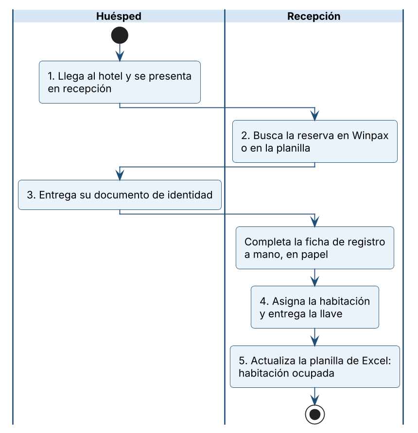

**Figura 3.** Cursograma del proceso de check-in actual (2026). Fuente: elaboración propia.

**Descripción**

1. El huésped llega al hotel y se presenta en recepción.
2. El recepcionista busca la reserva en Winpax o en la planilla.
3. Se le solicita al huésped un documento de identidad y se completa la ficha de registro de
   forma manual, en papel.
4. Se le asigna la habitación y se le entrega la llave.
5. El recepcionista actualiza la planilla de Excel marcando la habitación como ocupada.

**Problemas detectados**

- La ficha de registro es en papel, lo que dificulta buscar los datos del huésped después.
- La asignación de la habitación se hace manualmente, sin un sistema que muestre de un vistazo
  qué unidades están libres y en qué estado.

### 2.3.3. Proceso de check-out y facturación (actual)

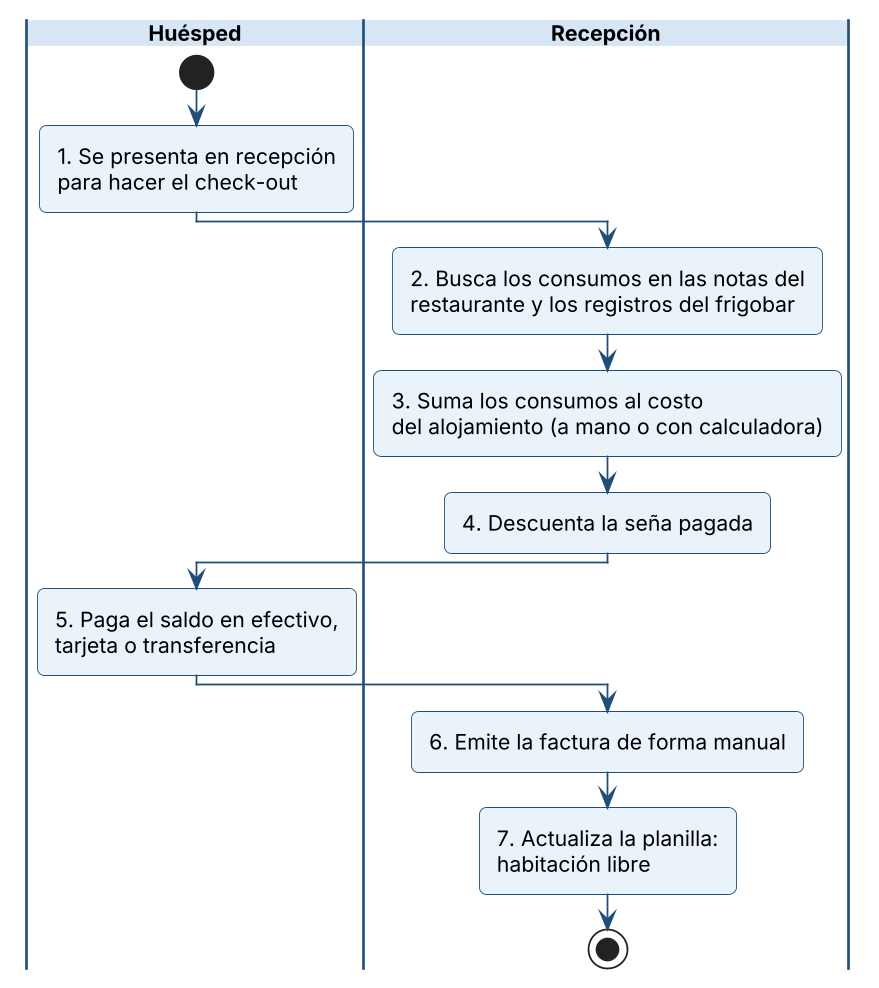

**Figura 4.** Cursograma del proceso de check-out y facturación actual (2026). Fuente: elaboración propia.

**Descripción**

1. El huésped se presenta en recepción para hacer el check-out.
2. El recepcionista busca los consumos del huésped en las notas del restaurante y en los
   registros del frigobar (todo manual).
3. Se suman los consumos al costo del alojamiento.
4. Se descuenta la seña pagada previamente.
5. Se cobra el saldo restante (efectivo, tarjeta o transferencia).
6. Se emite la factura de forma manual.
7. Se actualiza la planilla marcando la habitación como libre.

**Problemas detectados**

- Los consumos se registran en notas sueltas, con riesgo de perder o duplicar información.
- La facturación es manual y no está integrada con la facturación electrónica.
- No hay un cálculo automático del total: el recepcionista suma todo a mano o con calculadora.

### 2.3.4. Proceso de limpieza de habitaciones (actual)

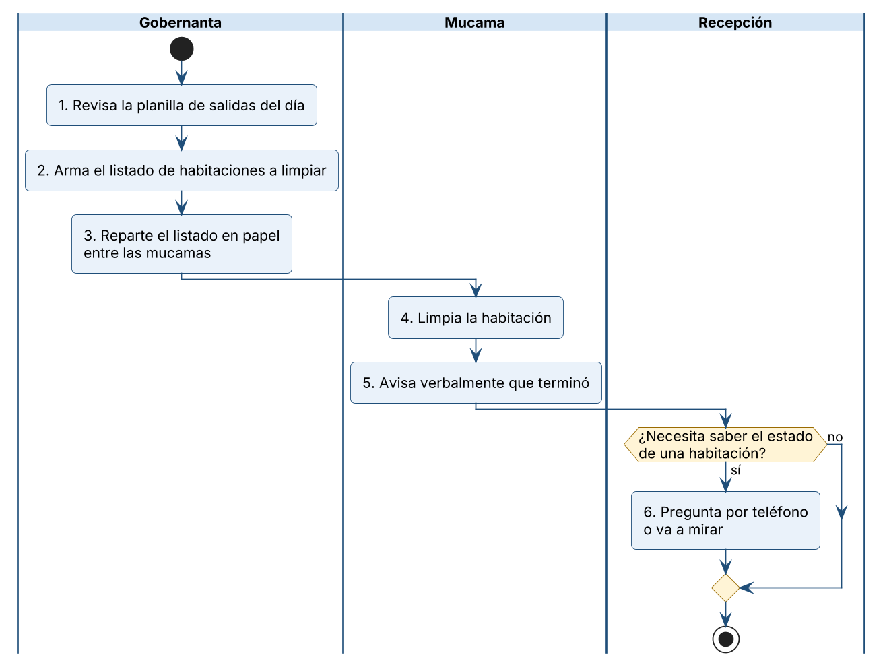

**Figura 5.** Cursograma del proceso de limpieza de habitaciones actual (2026). Fuente: elaboración propia.

**Descripción**

1. La gobernanta revisa la planilla de salidas del día.
2. Arma a mano el listado de habitaciones a limpiar.
3. Reparte el listado entre las mucamas, en papel.
4. Cada mucama limpia la habitación.
5. Al terminar, avisa verbalmente.
6. Recepción se entera del estado de una habitación preguntando por teléfono o yendo a mirar.

**Problemas detectados**

- El orden de limpieza no considera las llegadas del día: una habitación con ingreso previsto
  puede quedar para el final del turno.
- El estado de la habitación solo existe de palabra: recepción no puede confirmarle a un
  huésped si su habitación está lista.

## 2.4. Tecnología

### 2.4.1. Tecnología existente en la empresa

| Categoría | Elemento | Descripción y estado actual |
|---|---|---|
| Software | Winpax | Sistema de gestión hotelera heredado. Solo funciona en Windows. No tiene acceso web ni integración con pasarelas de pago. |
| Software | Excel / planillas | Se usan para el control de disponibilidad, el registro de consumos y los reportes. Propensas a errores humanos. |
| Software | Booking.com | Canal de venta en línea que aporta el 66 % de las reservas. Cobra una comisión equivalente al 10,76 % de los ingresos totales. |
| Software | Expedia | Canal de venta en línea secundario (13 %). Comisión del 0,32 % de los ingresos totales. |
| Software | Correo electrónico | Comunicación con los huéspedes. Envío manual de las confirmaciones. |
| Hardware | PC de escritorio | 2 equipos en recepción (uno por turno), con Windows. |
| Hardware | Impresora | 1 impresora multifunción para facturas y fichas de registro. |
| Conectividad | WiFi + red cableada | Red WiFi para huéspedes y red cableada interna para las PC de recepción. |
| Conectividad | Internet | Servicio por fibra óptica, estable para la zona. |

Las pantallas de los sistemas que el hotel usa hoy —Winpax y el extranet de Booking.com— se
reproducen en el **Anexo D**, con una descripción de qué resuelve cada una.

### 2.4.2. Tecnología existente en el mercado (aplicable)

Se relevaron las tecnologías disponibles en el mercado que resuelven las necesidades
detectadas. La tabla presenta las que se adoptaron para la solución.

| Tecnología | Tipo | Aplicación en la solución |
|---|---|---|
| Next.js (sobre React) y TypeScript | Framework web | Construye en un solo proyecto la interfaz del portal de reservas, el panel de gestión y la lógica del servidor. |
| PostgreSQL | Base de datos relacional | Almacena reservas, huéspedes, unidades, consumos, pagos y facturas. Permite impedir desde la propia base que dos reservas se superpongan sobre la misma unidad. |
| Supabase | Plataforma de base de datos en la nube | Provee PostgreSQL administrado, la autenticación del personal, la seguridad por rol sobre cada tabla y el almacenamiento de archivos. |
| Tailwind CSS | Framework de estilos | Interfaz adaptable a computadora, tableta y teléfono. |
| Mercado Pago, Stripe y Payway | Pasarelas de pago | Cobro en línea de la seña y del saldo, en pesos y en dólares. |
| Resend | Servicio de correo transaccional | Envío automático de confirmaciones, recordatorios y encuestas al huésped. |
| Vitest y Playwright | Herramientas de prueba | Verificación automática de las reglas de negocio y recorrido de las pantallas. |
| Git y GitHub | Control de versiones | Trabajo colaborativo del equipo y verificación automática de cada cambio. |
| Vercel | Alojamiento en la nube | Publica la aplicación con acceso desde cualquier lugar. |

# 3. Propuesta

## 3.1. Diagnóstico y Propuesta

A partir del relevamiento se identificaron los siguientes puntos débiles y se propone una
solución para cada uno.

| Diagnóstico | Propuesta |
|---|---|
| La verificación de disponibilidad se hace de forma manual en planillas de Excel, lo que genera riesgo de sobreventa. | Consulta de disponibilidad en tiempo real contra la base de datos, que bloquea automáticamente la unidad al crear la reserva e impide que dos reservas se superpongan. |
| Las reservas directas (21 % del total) no reciben confirmación automática. El recepcionista envía los correos a mano. | Envío automático del correo de confirmación al huésped con el código de reserva, las fechas y el detalle del alojamiento. |
| No existe un portal web propio para que el huésped reserve directamente. El hotel depende en un 66 % de Booking, con comisiones del 10,76 %. | Portal web de reservas propio integrado al sistema, que permite reducir la dependencia de las agencias en línea y aumentar las reservas directas. |
| Los consumos del huésped (frigobar, restaurante, lavandería) se registran en notas de papel, con riesgo de pérdida. | Módulo digital de registro de consumos, vinculado a la estadía del huésped, con cálculo automático del total al momento del check-out. |
| La facturación es manual y no está integrada con el sistema de gestión. | Generación de la factura desde la cuenta del huésped al momento del check-out, con el detalle de alojamiento, consumos y servicios adicionales y el IVA discriminado. |
| No hay reportes gerenciales automatizados. Los datos se arman a mano mes a mes. | Reportes de ocupación, tarifa promedio, ingreso por habitación disponible, venta por categoría y facturación, con comparación contra el mes anterior. |
| El sistema actual (Winpax) solo funciona en Windows y no se puede usar desde fuera del hotel. | Sistema web en la nube, accesible desde cualquier navegador y dispositivo, incluidos teléfonos y tabletas. |
| No existe una política de cancelación automatizada. Se gestiona caso por caso. | Política de cancelación cargada en el sistema, que calcula el cargo según el plazo y lo muestra antes de confirmar la cancelación. |
| El listado de limpieza se arma a mano y el estado de cada habitación se informa de palabra. | Tablero de housekeeping que ordena las unidades por prioridad y registra el estado de limpieza de cada una, visible para recepción. |

**Sobre la factura y la impresora fiscal.** La factura no se emite por impresora fiscal
(controlador fiscal). El sistema trabaja con el régimen de factura electrónica: arma el
comprobante con numeración correlativa e IVA discriminado y solicita el código de autorización
electrónico (CAE) a través de un servicio web. El comprobante se imprime en la impresora común
de recepción o se guarda en PDF, y el huésped también puede descargarlo desde su reserva. Para
emitir con validez fiscal, el hotel debe gestionar su certificado digital ante el organismo
recaudador y cargar sus datos fiscales en el sistema.

## 3.2. Propuesta General

Se propone el desarrollo de un Sistema Integral de Gestión Hotelera para el Hotel Blanca
Patagonia, implementado como aplicación web accesible desde cualquier dispositivo con conexión
a internet. El sistema se organiza en dos vistas separadas:

- **Portal público de reservas**, sin cuenta: es donde el huésped consulta la disponibilidad,
  ve el precio final, reserva y paga la seña.
- **Panel interno de gestión**, con inicio de sesión y permisos según el puesto de trabajo
  (administrador, gerencia, recepción y housekeeping): es donde opera el personal del hotel.

**Módulos principales**

- **Reservas y estadías.** Permite a los huéspedes reservar en línea con verificación de
  disponibilidad en tiempo real, cálculo automático del precio según la temporada y el tipo de
  alojamiento, aplicación de promociones y pago integrado a través de la pasarela. Recepción
  carga las reservas de mostrador, ve la grilla de ocupación y puede reprogramar, cambiar de
  unidad o cancelar.
- **Check-in / check-out.** El recepcionista gestiona los ingresos y egresos de forma digital,
  reemplazando las fichas de papel. Al momento del check-out, el sistema consolida
  automáticamente el alojamiento, los consumos y los servicios adicionales para emitir la
  factura.
- **Consumos y servicios.** Registra los consumos de frigobar, restaurante, lavandería y
  excursiones vinculados a cada estadía en curso, desde un punto de venta organizado por
  departamento.
- **Cuenta, pagos y facturación.** Registra la seña, el saldo y los reembolsos; cobra en línea
  en pesos o en dólares; emite la factura y, cuando hace falta corregirla, la nota de crédito.
- **Huéspedes.** Mantiene la ficha de cada huésped con su historial de estadías.
- **Housekeeping.** Muestra las unidades a limpiar ordenadas por prioridad y registra su
  estado; las mucamas lo usan desde el teléfono.
- **Reportes.** Genera los informes de ocupación, tarifa promedio, ingreso por habitación
  disponible, venta por categoría, facturación y satisfacción del huésped.
- **Administración.** Gestiona el inventario de unidades, los tipos de alojamiento, las
  tarifas por temporada, las promociones vigentes y los usuarios del sistema, y permite
  consultar la auditoría de las operaciones.

**Tecnología propuesta**

| Tecnología | Para qué se usa | Por qué se eligió |
|---|---|---|
| Next.js 16 con TypeScript | Portal, panel de gestión y lógica del servidor | Reúne la interfaz y el servidor en un solo proyecto y un solo despliegue, sin construir por separado una capa de servicios. El tipado detecta errores antes de ejecutar. |
| PostgreSQL (administrado por Supabase) | Base de datos | Es una base relacional madura, y permite garantizar desde la propia base que una unidad no se reserve dos veces para las mismas fechas. |
| Supabase | Autenticación, seguridad por rol y almacenamiento | Evita montar y mantener servidores propios. Los permisos de cada rol se aplican en la base de datos, no solo en las pantallas. |
| Tailwind CSS 4 | Diseño de la interfaz | Permite una interfaz propia y adaptable a cualquier tamaño de pantalla. |
| Mercado Pago, Stripe y Payway | Cobro en línea | El hotel recibe turismo nacional e internacional: se cubre el cobro en pesos con medios locales y el cobro con tarjeta internacional. El sistema nunca almacena datos de tarjetas. |
| Resend | Envío de correo | Servicio de correo transaccional con dominio propio verificado, que se integra por una interfaz web simple. |
| Vitest y Playwright | Pruebas | Permiten verificar automáticamente las reglas de negocio y las pantallas en cada cambio. |
| Git y GitHub | Control de versiones | Historial completo del desarrollo y verificación automática antes de integrar cada cambio. |

**Alojamiento (hosting).** La aplicación se publica en **Vercel**, plataforma en la nube
especializada en Next.js, que despliega automáticamente cada versión aprobada desde GitHub y
entrega el sitio por HTTPS. La base de datos, la autenticación y los archivos se alojan en
**Supabase**. Ninguno de los dos requiere que el hotel instale o mantenga servidores: desde
cada puesto solo hace falta un navegador.

**Cuadro de costos de licenciamiento**

Valores de referencia publicados por cada proveedor, consultados en noviembre de 2026. Los
planes gratuitos alcanzan para la etapa de demostración; para la operación diaria del hotel se
recomiendan los planes pagos indicados.

| Componente | Licencia o plan | Costo | Observación |
|---|---|---|---|
| Next.js, React, TypeScript, Tailwind CSS, PostgreSQL, Vitest, Playwright | Código abierto | USD 0 | Sin costo de licencia. |
| Git y GitHub | Plan gratuito | USD 0 | Repositorio y verificación automática. |
| Vercel (alojamiento) | Hobby: USD 0 · Pro: USD 20 por mes | USD 20 por mes | El plan gratuito es solo para uso no comercial; el uso comercial y las tareas programadas frecuentes requieren el plan Pro. |
| Supabase (base de datos) | Free: USD 0 · Pro: USD 25 por mes | USD 25 por mes | El plan gratuito pausa el proyecto tras una semana sin actividad y no incluye copias de seguridad; el plan Pro agrega copias diarias. |
| Resend (correo) | Free: USD 0 (3.000 correos por mes, 100 por día) · Pro: USD 20 por mes (50.000 correos) | USD 0 | El plan gratuito cubre el volumen actual del hotel (351 reservas en marzo de 2026). |
| Mercado Pago | Sin abono mensual | Comisión por cobro | Entre 1,49 % y 6,29 % + IVA según el plazo de acreditación elegido. |
| Stripe y Payway | Sin abono mensual | Comisión por cobro | Según la tarifa vigente de cada pasarela y el acuerdo comercial del hotel. |
| Dominio | Ya contratado | — | El hotel ya posee el dominio blancapatagonia.com. |
| Facturación electrónica | Certificado digital | Sin costo de licencia | Lo gestiona el hotel ante el organismo recaudador. |
| **Total fijo estimado** | | **USD 45 por mes** | Vercel Pro + Supabase Pro. Las comisiones de las pasarelas se pagan solo sobre lo cobrado. |

Como referencia, la comisión que el hotel pagó a Booking en marzo de 2026 fue de $ 13.260.237:
cada reserva que pase del canal de la agencia al portal propio paga una comisión de pasarela
menor y no paga comisión de intermediación.

# 4. Anexos

Se adjuntan como material complementario los siguientes documentos proporcionados por la
administración del hotel.

- **Anexo A:** Tarifario de la temporada 2025/2026 (IVA discriminado): precios por tipo de
  habitación, temporada y condiciones de reserva.
- **Anexo B:** Informe gerencial de marzo de 2026: datos reales de ocupación, costos,
  ingresos, distribución de canales y reputación en línea.
- **Anexo C:** Firma del comitente (Franco Theo Cheli, Director de Blanca Patagonia S.A.S.).
- **Anexo D:** Sistemas que el hotel utiliza actualmente (Winpax y extranet de Booking.com).

Los documentos originales de los anexos A y B se entregan en formato PDF junto con este
trabajo.

## Anexo A — Resumen del Tarifario

**Temporadas definidas por el hotel**

| Temporada | Períodos |
|---|---|
| Baja | 01/09 al 30/09 de 2025 · 05/04 al 31/05 de 2026 |
| Media | 01/10 al 31/10 de 2025 · 01/12 al 19/12 de 2025 · 01/03 al 28/03 de 2026 |
| Alta | 01/11 al 30/11 de 2025 · 20/12 de 2025 al 29/02 de 2026 · 29/03 al 04/04 de 2026 |

**Política de cancelación** (textual del tarifario)

- Hasta 14 días antes del check-in: sin cargo.
- Entre 14 y 7 días antes: se cobra la primera noche.
- Dentro de los 7 días: se cobra el 100 % de la estadía.
- No-show: se cobra el 100 % de la estadía.

## Anexo B — Informe Gerencial de marzo de 2026

Los datos del informe se resumen en la tabla de dimensionamiento de la sección 2.1 y en la
distribución de reservas por canal. El documento original se entrega en PDF.

## Anexo C — Firma del comitente

<!-- docx: imagen figuras/anexos/firma-comitente.jpg, centrada, con la aclaración debajo. -->

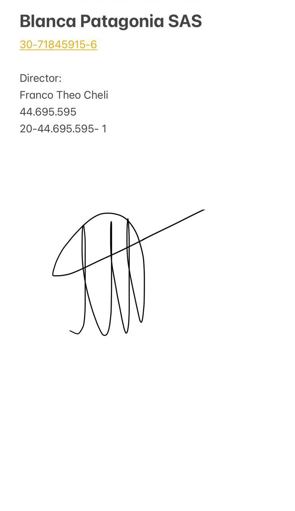

**Franco Theo Cheli** — Director de Blanca Patagonia S.A.S. · DNI 44.695.595

En conformidad con el pedido del usuario detallado en la sección 1.2.

## Anexo D — Sistemas que el hotel utiliza actualmente

Capturas provistas por el comitente durante el relevamiento. Los nombres de huéspedes y de
empleados fueron difuminados.

**Winpax.** Es el sistema de gestión hotelera que el hotel usa hoy (versión 9, construido
sobre Oracle Forms). Se instala en las PC de recepción y solo funciona dentro del hotel.

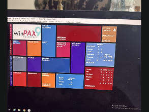

**Figura D.1.** Winpax 9: menú principal (2026). Fuente: Hotel Blanca Patagonia, captura provista por el comitente.

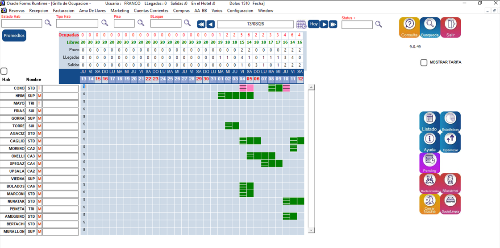

**Figura D.2.** Winpax 9: grilla de ocupación, con una fila por habitación y una columna por día (2026). Fuente: Hotel Blanca Patagonia, captura provista por el comitente.

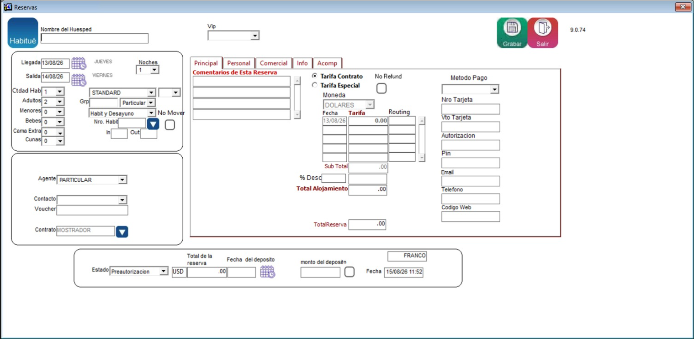

**Figura D.3.** Winpax 9: alta de reserva (2026). Fuente: Hotel Blanca Patagonia, captura provista por el comitente.

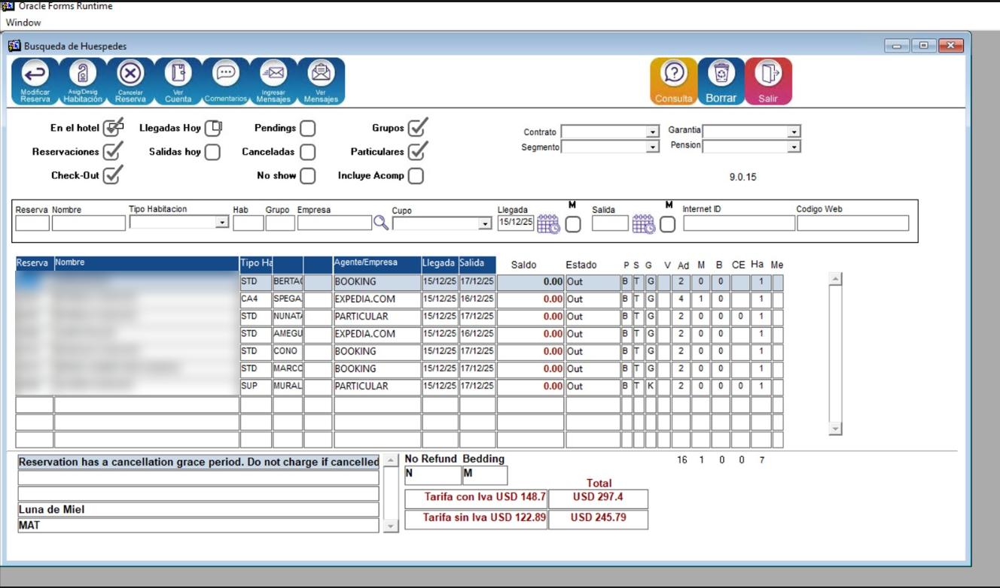

**Figura D.4.** Winpax 9: búsqueda de huéspedes y reservas (2026). Fuente: Hotel Blanca Patagonia, captura provista por el comitente.

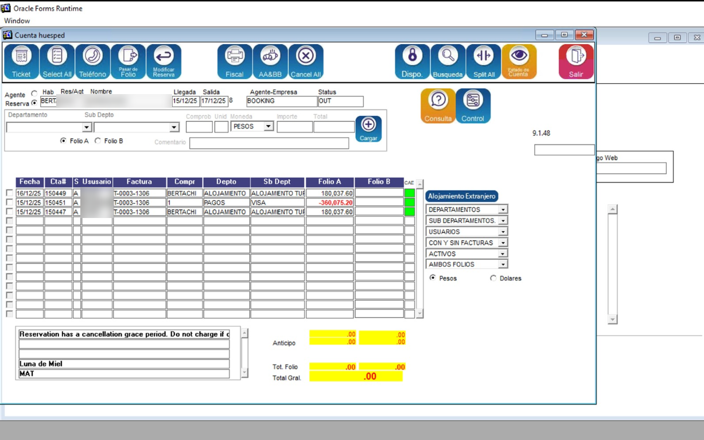

**Figura D.5.** Winpax 9: cuenta del huésped, con los cargos repartidos en dos folios (2026). Fuente: Hotel Blanca Patagonia, captura provista por el comitente.

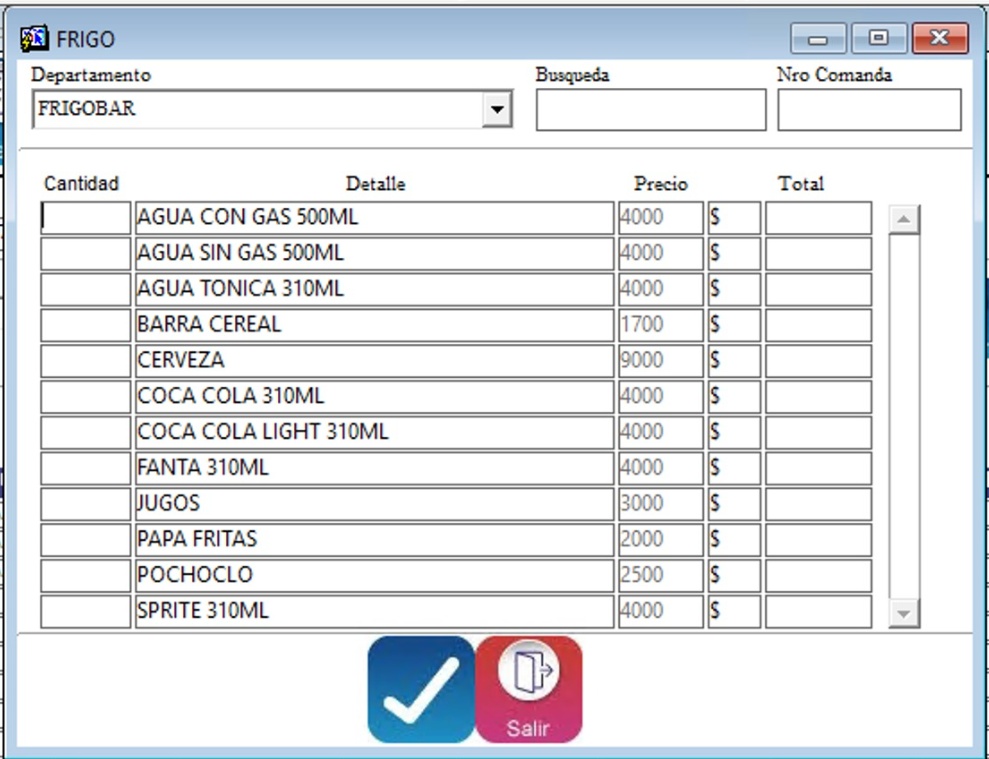

**Figura D.6.** Winpax 9: carga de consumos de frigobar (2026). Fuente: Hotel Blanca Patagonia, captura provista por el comitente.

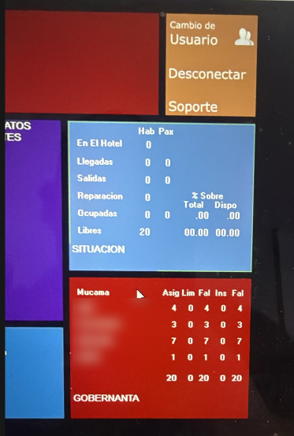

**Figura D.7.** Winpax 9: situación del hotel y tablero de la gobernanta (2026). Fuente: Hotel Blanca Patagonia, captura provista por el comitente.

**Extranet de Booking.com.** Es el panel donde el hotel administra sus reservas, tarifas y
mensajes dentro de la agencia en línea. Las reservas que llegan por este canal figuran
también en Winpax, con Booking como agente (Figura D.4).

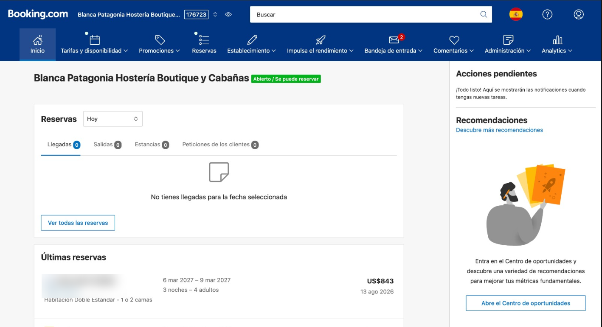

**Figura D.8.** Extranet de Booking.com: pantalla de inicio del establecimiento (2026). Fuente: Booking.com, captura provista por el comitente.

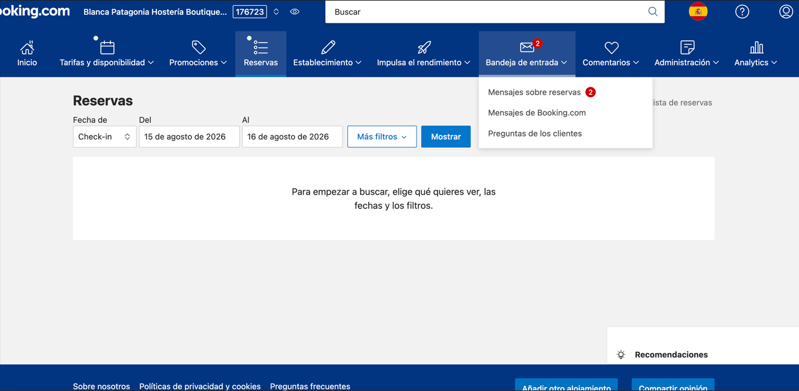

**Figura D.9.** Extranet de Booking.com: consulta de reservas (2026). Fuente: Booking.com, captura provista por el comitente.

# 5. Glosario

| Término | Definición |
|---|---|
| **ADR** | *Average Daily Rate*: tarifa promedio por noche vendida. |
| **Agencia en línea (OTA)** | *Online Travel Agency*: agencia de viajes en línea (Booking, Expedia, etc.). |
| **CAE** | Código de Autorización Electrónico: código que autoriza una factura electrónica. |
| **Check-in** | Proceso de registro del huésped al llegar al hotel. |
| **Check-out** | Proceso de cierre de la estadía y liquidación de la cuenta del huésped. |
| **Comanda** | Pedido de consumos que se carga de una vez a la cuenta de un huésped. |
| **CUIT** | Clave Única de Identificación Tributaria. |
| **Folio** | Cada una de las partes en que se divide la cuenta de un huésped. |
| **Housekeeping** | Área encargada de la limpieza y preparación de las habitaciones. |
| **IVA** | Impuesto al Valor Agregado (21 % en la Argentina). |
| **Neto** | Tarifa para agencias de viajes (precio con descuento mayorista). |
| **No-show** | Cuando el huésped no se presenta en la fecha de check-in reservada. |
| **Overbooking** | Sobreventa: aceptar más reservas que unidades disponibles. |
| **Pernocte** | Cada noche que un huésped se aloja en el hotel. |
| **Pick-up** | Cantidad de reservas nuevas captadas en un período. |
| **Rack** | Tarifa de mostrador (precio sin descuento de agencia). |
| **RevPAR** | *Revenue Per Available Room*: ingreso por habitación disponible. |
| **Seña** | Pago anticipado (primera noche) para confirmar la reserva. |
| **Winpax** | Sistema de gestión hotelera heredado que usa actualmente el hotel. |
