# PARTE 2: MODELADO Y DESARROLLO DEL SISTEMA

> Capítulos 4 a 6 de la tesis: objetivos, requerimientos y análisis y diseño del producto.
> Los capítulos 7 a 9 (implementación, integración y testing, especificaciones) están en
> `parte-3-implementacion-y-especificaciones.md`. Las figuras están en `figuras/`.

# 4. Objetivos, Límites y Alcance

## 4.1. Objetivo general

Desarrollar e implementar un Sistema Integral de Gestión Hotelera para el Hotel Blanca
Patagonia que reemplace a Winpax y a las planillas de cálculo, permita al huésped reservar
directamente desde un portal propio y le dé al personal una única herramienta, accesible desde
cualquier dispositivo, para gestionar reservas, estadías, consumos, cobros, facturación y
reportes.

## 4.2. Objetivos específicos

1. Impedir la sobreventa: garantizar que una misma unidad no pueda reservarse dos veces para
   fechas que se superponen, aun cuando dos personas operen al mismo tiempo.
2. Ofrecer un portal público donde el huésped consulte la disponibilidad, vea el precio final
   con impuestos, reserve y pague la seña, sin intermediarios.
3. Confirmar las reservas de forma automática por correo electrónico.
4. Reemplazar la ficha de papel por el registro digital del check-in y del check-out.
5. Registrar los consumos de cada estadía en el momento en que se producen y consolidarlos en
   la cuenta del huésped.
6. Emitir la factura desde la cuenta, con el IVA discriminado y la numeración correlativa.
7. Organizar la limpieza de las unidades por prioridad y hacer visible su estado para recepción.
8. Entregar a la gerencia los indicadores de ocupación, tarifa promedio e ingresos sin armarlos
   a mano.
9. Controlar el acceso según el puesto de trabajo y dejar registro de las operaciones sensibles.

## 4.3. Alcance

El sistema comprende dos vistas: el **portal público**, que usa el huésped sin necesidad de
cuenta, y el **panel de gestión**, que usa el personal con usuario y contraseña. El alcance
funcional, por módulo, es el siguiente.

| Módulo | Qué incluye |
|---|---|
| **Portal público** | Portada y catálogo de alojamientos; consulta de disponibilidad con precio final; reserva con datos del huésped; pago en línea de la seña y del saldo; página de la reserva con su estado; descarga de la factura; encuesta de satisfacción; asistente de preguntas frecuentes. |
| **Reservas y estadías** | Alta de reservas de mostrador y de grupo; grilla de ocupación; listado con vistas operativas (llegadas, salidas, alojados, con saldo); ficha de la reserva; check-in y check-out; cancelación con la política del tarifario; reprogramación de fechas; cambio de unidad. |
| **Consumos** | Punto de venta con el catálogo por departamento; carga por comanda con control de stock; anulación de comandas; reparto de la cuenta en dos folios. |
| **Cuenta, pagos y facturación** | Registro de seña, saldo y reembolso; cobro en pesos o en dólares con la cotización del día; enlace de pago para enviar al huésped; factura con IVA discriminado; nota de crédito. |
| **Huéspedes** | Ficha con datos de contacto y condición fiscal; historial de estadías; detección y fusión de fichas duplicadas; puntos de fidelidad. |
| **Housekeeping** | Tablero con el estado de cada unidad; asignación de mucamas; vista para el teléfono con las tareas ordenadas por prioridad; registro de cada limpieza. |
| **Reportes** | Ocupación, tarifa promedio (ADR) e ingreso por habitación disponible (RevPAR); venta por categoría; facturación y medios de cobro; reservas por estado; satisfacción del huésped; exportación de listados a planilla. |
| **Administración** | Usuarios y roles; tipos de alojamiento y unidades; tarifario por temporada; temporadas; promociones; catálogo de productos; cotización de divisas; datos fiscales del hotel; auditoría; registro de errores; ayuda. |

El panel se organiza en doce áreas, y cada rol ve solo las que le corresponden (sección 5.1).

## 4.4. Límites

- **Desde:** el momento en que un huésped consulta la disponibilidad o el personal carga una
  reserva.
- **Hasta:** la emisión de la factura, el registro del cobro y la respuesta de la encuesta de
  satisfacción posterior a la estadía.

El sistema abarca la operación de alojamiento del hotel. Quedan fuera de sus límites la
contabilidad general, la liquidación de sueldos y la gestión interna del restaurante: de este
último solo se registran los consumos que se cargan a la cuenta de un huésped alojado.

## 4.5. Supuestos y restricciones

- El hotel dispone de conexión a internet estable en recepción (relevada en la sección 2.4.1).
- Cada integrante del personal opera con su propio usuario; no se comparten cuentas.
- Los precios se administran en dólares estadounidenses; el cobro en pesos se hace a la
  cotización de venta del día de pago, como establece el tarifario.
- El tarifario cargado es el de la temporada 2025/2026 provisto por el hotel (Anexo A). Las
  temporadas y tarifas de ciclos posteriores las carga el hotel desde Administración.
- Para emitir comprobantes con validez fiscal el hotel debe tramitar su certificado digital;
  hasta entonces el sistema funciona con un proveedor de facturación de demostración, que
  identifica cada comprobante como no válido fiscalmente.
- Para cobrar en línea el hotel debe contratar al menos una pasarela y cargar sus credenciales.
- El sistema no almacena números de tarjeta ni códigos de seguridad en ningún caso.

# 5. Especificación de Requerimientos

## 5.1. Actores

| Actor | Descripción | Acceso |
|---|---|---|
| **Huésped** | Persona que consulta, reserva y paga desde el portal. No tiene cuenta: accede a su reserva por un enlace personal. | Portal público |
| **Recepción** | Personal del mostrador. Gestiona reservas, check-in, check-out, consumos, cobros y facturas. | Inicio, Ocupación, Punto de venta, Reservas, Huéspedes, Ayuda |
| **Housekeeping** | Gobernanta y mucamas. Consultan las tareas de limpieza y registran el estado de las unidades. | Inicio, Housekeeping, Ayuda |
| **Gerencia** | Dirección del hotel. Consulta los reportes y mantiene tarifas y catálogo. | Lo de Recepción, más Housekeeping, Reportes, Configuración y Errores del sistema |
| **Administrador** | Responsable del sistema. Gestiona usuarios y consulta la auditoría. | Las doce áreas, incluidas Usuarios y Auditoría |
| **Pasarela de pagos** | Servicio externo que cobra y avisa al sistema cuando un pago se acredita. | Aviso firmado |
| **Servicio de correo** | Servicio externo que entrega los avisos al huésped. | — |
| **Facturación electrónica** | Servicio que autoriza cada comprobante con un código (CAE). | — |
| **Fuente de cotización** | Servicio público del que se toma la cotización del dólar. | — |

## 5.2. Requerimientos funcionales

**Portal público**

| ID | Requerimiento |
|---|---|
| RF-01 | Mostrar el catálogo de alojamientos con sus fotos, comodidades, capacidad y precio desde. |
| RF-02 | Informar, para unas fechas y una cantidad de personas, qué tipos de alojamiento están disponibles y a qué precio final. |
| RF-03 | Registrar la reserva con los datos del huésped y generar un código de reserva. |
| RF-04 | Cobrar la seña o el saldo en línea y confirmar la reserva cuando el pago se acredita. |
| RF-05 | Mostrar al huésped el estado de su reserva y permitirle descargar su factura. |
| RF-06 | Recibir la encuesta de satisfacción del huésped. |

**Reservas y estadías**

| ID | Requerimiento |
|---|---|
| RF-07 | Cargar reservas de mostrador eligiendo fechas, tipo y unidad, con el precio calculado por el sistema. |
| RF-08 | Mostrar la grilla de ocupación por unidad y por día. |
| RF-09 | Listar las reservas con búsqueda, filtros y vistas operativas (llegadas, salidas, alojados). |
| RF-10 | Registrar el check-in y el check-out de una reserva. |
| RF-11 | Cancelar una reserva calculando el cargo que corresponde según la política. |
| RF-12 | Reprogramar las fechas de una reserva recalculando su precio. |
| RF-13 | Cambiar una reserva de unidad, desde la ficha o arrastrándola en la grilla. |
| RF-14 | Liberar automáticamente las reservas del portal que no registran la seña dentro del plazo. |

**Consumos**

| ID | Requerimiento |
|---|---|
| RF-15 | Cargar a la cuenta de una estadía en curso uno o varios productos en una misma comanda. |
| RF-16 | Controlar el stock de los productos que lo llevan. |
| RF-17 | Anular una comanda mientras la cuenta esté abierta. |

**Cuenta, pagos y facturación**

| ID | Requerimiento |
|---|---|
| RF-18 | Mostrar la cuenta consolidada: alojamiento, consumos, pagos y saldo. |
| RF-19 | Registrar pagos en efectivo, transferencia o tarjeta, en dólares o en pesos. |
| RF-20 | Generar un enlace de pago para enviar al huésped. |
| RF-21 | Emitir la factura de la estadía con el tipo de comprobante y el IVA que correspondan. |
| RF-22 | Emitir notas de crédito sobre una factura. |

**Huéspedes**

| ID | Requerimiento |
|---|---|
| RF-23 | Registrar, editar y buscar huéspedes. |
| RF-24 | Mostrar el historial de estadías de un huésped. |
| RF-25 | Detectar fichas duplicadas y fusionarlas. |

**Housekeeping**

| ID | Requerimiento |
|---|---|
| RF-26 | Mostrar las unidades a limpiar ordenadas por prioridad, con el motivo. |
| RF-27 | Registrar el estado de limpieza de cada unidad. |
| RF-28 | Asignar las unidades a las mucamas. |

**Reportes**

| ID | Requerimiento |
|---|---|
| RF-29 | Calcular la ocupación, la tarifa promedio y el ingreso por habitación disponible de un mes y compararlos con el anterior. |
| RF-30 | Informar la venta por categoría de alojamiento, la facturación por medio de cobro y la satisfacción del huésped. |
| RF-31 | Exportar los listados a un archivo de planilla. |

**Administración**

| ID | Requerimiento |
|---|---|
| RF-32 | Dar de alta, modificar y dar de baja usuarios, asignándoles un rol. |
| RF-33 | Mantener los tipos de alojamiento, las unidades, las temporadas, las tarifas y las promociones. |
| RF-34 | Mantener el catálogo de productos y servicios con su stock. |
| RF-35 | Obtener la cotización del dólar y permitir cargarla a mano. |
| RF-36 | Registrar quién hizo cada operación sensible y permitir consultarlo. |
| RF-37 | Enviar al huésped los avisos por correo: confirmación, pago recibido, cancelación, recordatorio de llegada y encuesta. |

## 5.3. Requerimientos no funcionales

| ID | Categoría | Requerimiento | Cómo se resuelve |
|---|---|---|---|
| RNF-01 | Seguridad | Ningún dato personal es accesible sin autorización. | Las 30 tablas del sistema tienen seguridad por fila activa, con 55 políticas por rol. Sin sesión solo se lee el catálogo público. |
| RNF-02 | Seguridad | La autorización se verifica en el servidor. | Cada pantalla y cada operación del panel comprueba el rol antes de ejecutarse; escribir la dirección a mano no alcanza. |
| RNF-03 | Seguridad | El precio para agencias no es visible desde internet. | El público cotiza por una función que solo conoce la tarifa de mostrador, y no tiene permiso de lectura sobre la columna del precio neto. |
| RNF-04 | Seguridad | Las entradas públicas resisten el abuso automatizado. | Límite de intentos por origen en la reserva pública (5 por hora), el inicio de sesión, la recuperación de contraseña y la encuesta. |
| RNF-05 | Seguridad | Un usuario nuevo no recibe privilegios. | Nace sin rol y desactivado hasta que un administrador lo habilita. |
| RNF-06 | Seguridad | No se almacenan datos de tarjetas. | El cobro se hace en la página de la pasarela; el sistema guarda solo la marca y los últimos cuatro dígitos. |
| RNF-07 | Seguridad | Un aviso de pago no se aplica dos veces ni se acepta si no es auténtico. | Cada aviso se verifica por su firma y se identifica por una referencia única en la base. |
| RNF-08 | Auditoría | Las operaciones sensibles dejan rastro. | Disparadores en la base registran los cambios sobre pagos, tarifas y estados; además se registra quién consulta la ficha de un huésped. |
| RNF-09 | Integridad | La sobreventa es imposible. | Restricción de exclusión en la base sobre la unidad y el período de la estadía. |
| RNF-10 | Usabilidad | Nada queda oculto. | Las altas y ediciones van en pantalla propia con un botón visible; todo campo lleva su etiqueta. |
| RNF-11 | Usabilidad | Ninguna operación falla en silencio. | Toda escritura y toda lectura revisan el error y lo informan en pantalla en español. |
| RNF-12 | Usabilidad | No se puede enviar dos veces el mismo formulario. | El botón se bloquea al primer clic y las acciones irreversibles piden confirmación. |
| RNF-13 | Accesibilidad | Se puede usar desde el teléfono. | Diseño adaptable; housekeeping tiene una vista pensada para el teléfono. |
| RNF-14 | Accesibilidad | La información no depende solo del color. | Cada estado lleva además una letra o un texto. |
| RNF-15 | Disponibilidad | Se puede saber si el sistema está en pie. | Punto de consulta de salud que responde según si la base contesta, y registro de las tareas programadas. |
| RNF-16 | Disponibilidad | Un servicio externo mal configurado no pasa inadvertido. | En producción el sistema no arranca si falta declarar un proveedor. |
| RNF-17 | Mantenibilidad | Las reglas de negocio se prueban sin base de datos. | 57 módulos de reglas puras, separados de la interfaz y de los datos. |
| RNF-18 | Mantenibilidad | El esquema de datos evoluciona de forma reproducible. | 127 migraciones numeradas que no se modifican una vez aplicadas. |
| RNF-19 | Trazabilidad | Todo importe convertido conserva su cotización. | Cada pago guarda la moneda, el importe cobrado y el tipo de cambio aplicado. |
| RNF-20 | Regionalización | Las fechas y horas son las del hotel. | Todas se calculan y se muestran en la zona horaria de El Calafate. |

## 5.4. Reglas de negocio

| ID | Regla |
|---|---|
| RN-01 | Dos reservas activas no pueden superponerse sobre la misma unidad. |
| RN-02 | Ocupan inventario las reservas pendientes, confirmadas, pagadas y alojadas. |
| RN-03 | La reserva del portal nace pendiente; si no registra la seña en 5 días, se cancela y libera la unidad. |
| RN-04 | La seña es el importe de la primera noche. |
| RN-05 | Cancelación: con 15 días o más de anticipación, sin cargo; entre 14 y 7 días, la primera noche; con menos de 7 días, el total. El no-show paga el total. |
| RN-06 | Cada tipo de alojamiento tiene dos precios por temporada: neto (agencias) y rack (mostrador). |
| RN-07 | El canal define la tarifa: mostrador y portal venden a rack; Booking y Expedia, a neto. |
| RN-08 | Las tarifas se guardan sin IVA; al huésped siempre se le muestra el precio con IVA. |
| RN-09 | Una estadía que cruza de una temporada a otra se cotiza noche por noche. |
| RN-10 | El día de salida no cuenta como noche ocupada. |
| RN-11 | Las plazas ocupadas son adultos más menores; los bebés en cuna no ocupan plaza. |
| RN-12 | La moneda base es el dólar; el cobro en pesos se convierte a la cotización de venta y esa cotización queda guardada en el pago. |
| RN-13 | El precio de un consumo se congela al cargarlo. |
| RN-14 | La cuenta se cierra con la factura, no con el check-out: después de facturar no se cargan ni se quitan consumos. |
| RN-15 | Una reserva tiene como máximo una factura, y una factura emitida no se modifica: se corrige con una nota de crédito. |
| RN-16 | La letra del comprobante se deriva de la condición frente al IVA del hotel y del huésped. |
| RN-17 | La numeración fiscal es correlativa y sin saltos. |
| RN-18 | El alojamiento de un turista residente en el exterior que paga desde el exterior está exento de IVA; la exención se deduce de esos dos datos, no se marca a mano. |
| RN-19 | Prioridad de limpieza: primero las unidades sucias con llegada en el día. |
| RN-20 | Una reserva solo cambia de estado por las transiciones permitidas (Figura 41). |

# 6. Análisis y Diseño del Producto

## 6.1. Modelado Ambiental

### Declaración de propósito

El Sistema de Gestión Hotelera de Blanca Patagonia registra y controla el ciclo completo de
una estadía —reserva, ingreso, consumos, cobro, egreso y facturación— para que el hotel venda
sus unidades sin superposiciones, cobre lo que corresponde y conozca sus resultados.

### Diagrama de contexto

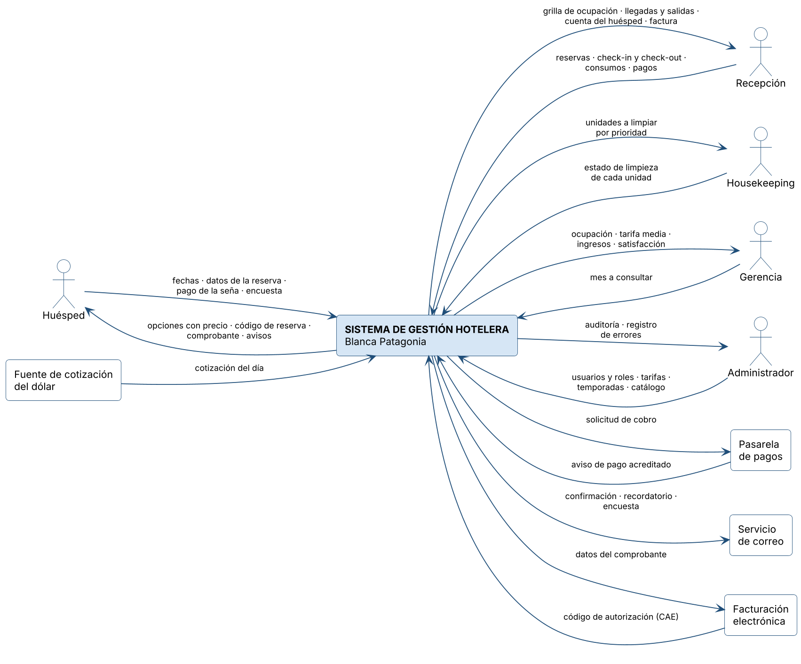

**Figura 6.** Diagrama de contexto del sistema (2026). Fuente: elaboración propia.

### Lista de acontecimientos

| N.º | Acontecimiento | Tipo | Respuesta del sistema |
|---|---|---|---|
| 1 | El huésped consulta la disponibilidad | Externo | Informa los alojamientos libres con su precio final. |
| 2 | El huésped reserva desde el portal | Externo | Crea la reserva pendiente y envía la confirmación. |
| 3 | La pasarela avisa que un pago se acreditó | Externo | Registra el pago y confirma la reserva. |
| 4 | Recepción carga una reserva de mostrador | Externo | Crea la reserva confirmada y bloquea la unidad. |
| 5 | Recepción registra el check-in | Externo | Pasa la reserva a alojada. |
| 6 | Recepción carga un consumo | Externo | Lo suma a la cuenta y descuenta el stock. |
| 7 | Recepción registra un pago | Externo | Actualiza el saldo de la reserva. |
| 8 | Recepción registra el check-out | Externo | Cierra la estadía y genera la encuesta. |
| 9 | Recepción emite la factura | Externo | Numera el comprobante, obtiene el CAE y cierra la cuenta. |
| 10 | Recepción cancela una reserva | Externo | Calcula el cargo, libera la unidad y avisa al huésped. |
| 11 | Housekeeping registra una limpieza | Externo | Actualiza el estado de la unidad. |
| 12 | El huésped responde la encuesta | Externo | Guarda el puntaje y el comentario. |
| 13 | Gerencia consulta un reporte | Externo | Calcula y muestra los indicadores. |
| 14 | El administrador da de alta un usuario | Externo | Crea el usuario con su rol. |
| 15 | Cada cinco minutos | Temporal | Envía los correos pendientes. |
| 16 | Una vez por día | Temporal | Cancela las reservas pendientes vencidas y depura el registro de errores. |

## 6.2. Modelado de Paquetes

El sistema se divide en ocho paquetes funcionales. La Figura 7 muestra los casos de uso de
cada uno; los cinco resaltados son los casos de uso principales, que se desarrollan en la
sección 6.3.

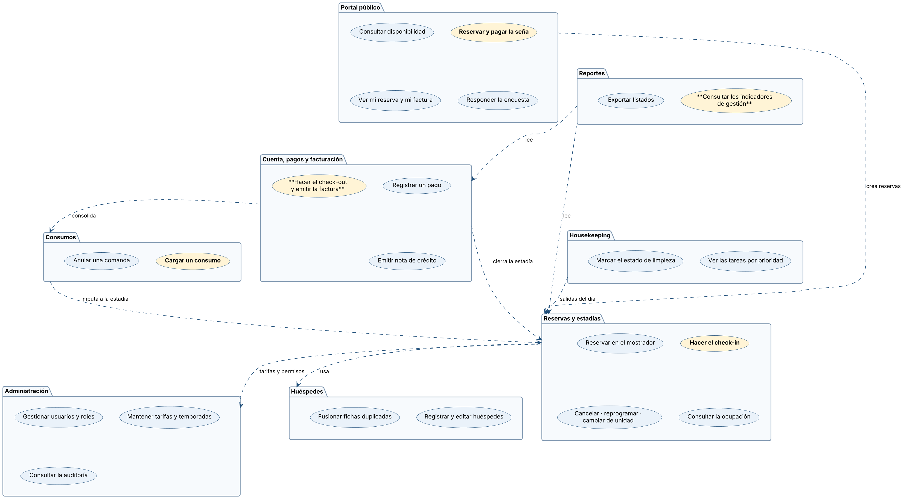

**Figura 7.** Diagrama de paquetes: módulos y casos de uso (2026). Fuente: elaboración propia.

Por dentro, la aplicación se organiza en tres capas (Figura 8). La presentación contiene el
portal, el panel y los puntos de entrada para servicios externos; la lógica concentra las
reglas de negocio, separadas de la interfaz y de los datos; y la capa de datos es la base
PostgreSQL, que además de almacenar hace cumplir las reglas críticas.

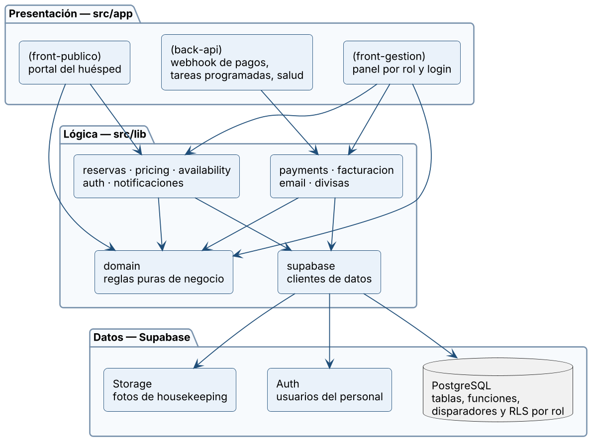

**Figura 8.** Arquitectura en capas del sistema (2026). Fuente: elaboración propia.

## 6.3. Modelado de los Casos de Uso

Se desarrollan los cinco casos de uso principales, uno por cada módulo del pedido del usuario.
Para cada uno se presentan los requerimientos específicos, los prototipos de interfaz, la
ficha, la vista estática y la vista dinámica.

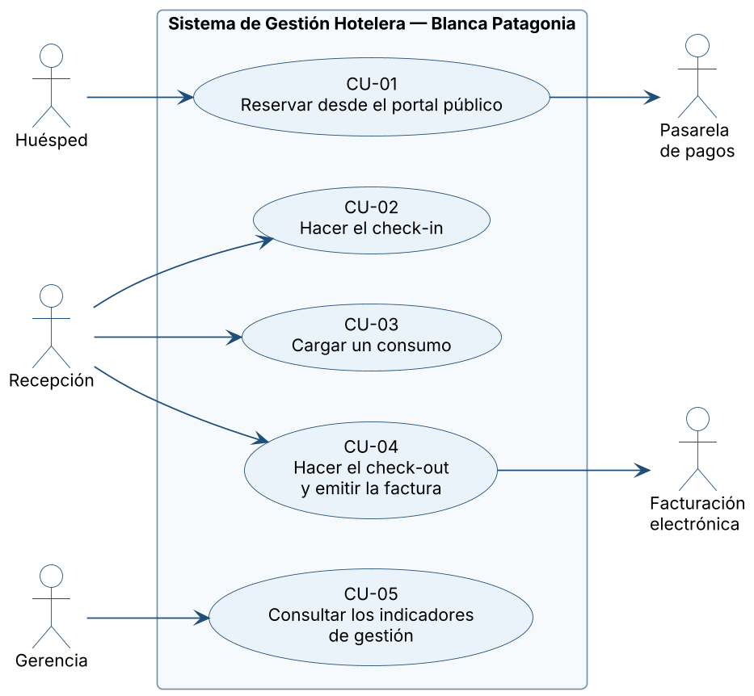

**Figura 9.** Diagrama general de los casos de uso principales (2026). Fuente: elaboración propia.

| Módulo | Caso de uso | Actor principal |
|---|---|---|
| Portal público / Reservas | CU-01 Reservar desde el portal público | Huésped |
| Reservas y estadías | CU-02 Hacer el check-in | Recepción |
| Consumos | CU-03 Cargar un consumo | Recepción |
| Cuenta, pagos y facturación | CU-04 Hacer el check-out y emitir la factura | Recepción |
| Reportes | CU-05 Consultar los indicadores de gestión | Gerencia |

### 6.3.1. Módulo Reservas — CU-01 Reservar desde el portal público

#### Requerimientos específicos

- RF-02, RF-03, RF-04 y RF-37.
- RN-01, RN-03, RN-04, RN-07, RN-08, RN-09 y RN-10.
- RNF-03, RNF-04, RNF-06, RNF-07 y RNF-09.
- El huésped no necesita crear una cuenta.
- El precio que ve el huésped es el final, con IVA, y es el mismo que después se cobra.

#### Prototipos de interfaz

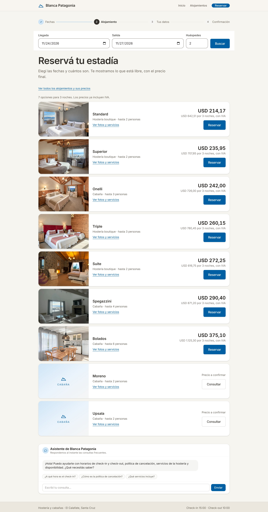

**Figura 10.** CU-01: disponibilidad y precios para las fechas elegidas (2026). Fuente: elaboración propia, captura del sistema.

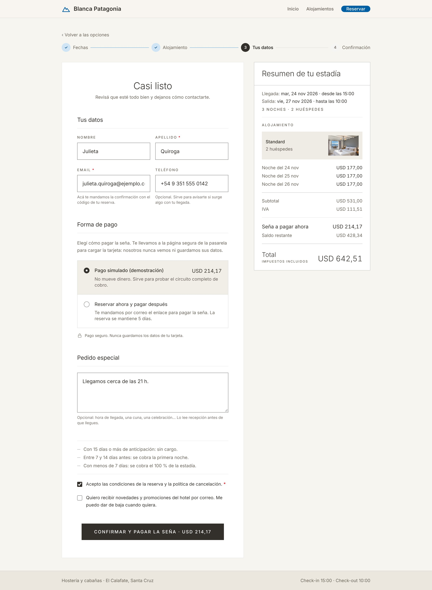

**Figura 11.** CU-01: datos del huésped, resumen de la estadía y forma de pago (2026). Fuente: elaboración propia, captura del sistema.

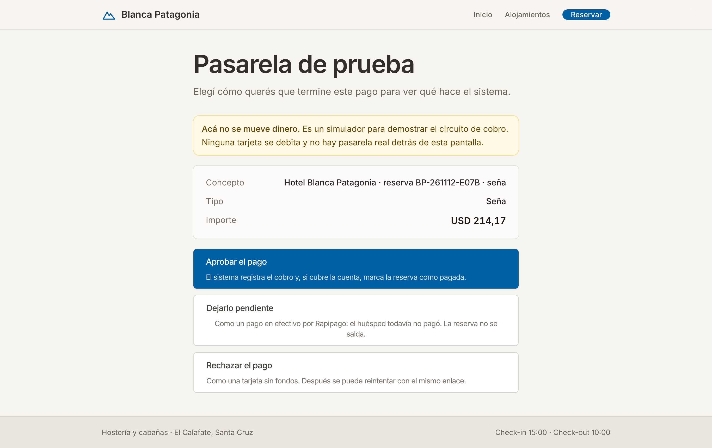

**Figura 12.** CU-01: pago de la seña en la pasarela de demostración (2026). Fuente: elaboración propia, captura del sistema.

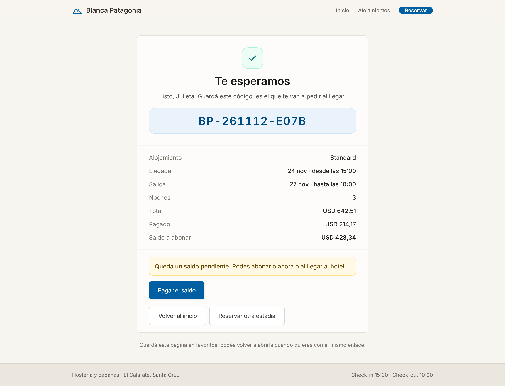

**Figura 13.** CU-01: confirmación de la reserva con su código (2026). Fuente: elaboración propia, captura del sistema.

#### Ficha de caso de uso

| | |
|---|---|
| **Nombre** | CU-01 Reservar desde el portal público |
| **Módulo** | Portal público / Reservas y estadías |
| **Actor principal** | Huésped |
| **Actores secundarios** | Pasarela de pagos, Servicio de correo |
| **Prioridad** | Alta |
| **Objetivo** | Que el huésped reserve un alojamiento para las fechas que elige y lo asegure pagando la seña, sin intervención del personal. |
| **Precondiciones** | Hay temporadas y tarifas cargadas para las fechas consultadas. Hay al menos una unidad activa del tipo elegido. |
| **Postcondiciones** | Queda registrada una reserva con su estadía, que bloquea la unidad. Si se pagó la seña, la reserva queda confirmada y el pago registrado; si no, queda pendiente por 5 días. El huésped recibió el correo de confirmación con su código. |

| Curso normal | Curso alternativo |
|---|---|
| 1. El huésped ingresa la fecha de llegada, la de salida y la cantidad de personas. | 1.1. Si las fechas son inválidas (salida anterior a la llegada o fechas pasadas), el sistema lo indica y no busca. |
| 2. El sistema muestra los tipos de alojamiento con unidades libres y su precio final para esas fechas. | 2.1. Si no hay disponibilidad, el sistema lo informa y propone cambiar las fechas. 2.2. Si para esas fechas no hay tarifa cargada, el sistema ofrece consultar al hotel en lugar de un precio. |
| 3. El huésped elige un alojamiento. | |
| 4. El sistema muestra el resumen de la estadía: precio por noche, subtotal, IVA, total, seña y saldo. | |
| 5. El huésped completa su nombre, apellido, correo y teléfono, y si quiere deja un pedido especial. | 5.1. Si falta un dato obligatorio o el correo no es válido, el sistema lo marca y no avanza. |
| 6. El huésped elige la forma de pago y acepta las condiciones de la reserva y la política de cancelación. | 6.1. Si elige «reservar ahora y pagar después», el caso sigue en el paso 8 y termina en el 9 con la reserva pendiente; el sistema le envía por correo el enlace para pagar la seña. |
| 7. El huésped confirma. | 7.1. Si desde ese origen se superó el límite de reservas por hora, el sistema pide esperar y no registra nada. |
| 8. El sistema registra al huésped (o reutiliza su ficha si el correo ya existe), crea la reserva pendiente con su estadía y encola el correo de confirmación. | 8.1. Si mientras tanto otra persona ocupó la última unidad, la base rechaza la reserva y el sistema informa que ya no hay disponibilidad. |
| 9. El sistema lleva al huésped a la página de la pasarela, donde paga la seña. | 9.1. Si el pago es rechazado, la reserva queda pendiente y el huésped puede reintentar desde la página de su reserva. |
| 10. La pasarela avisa al sistema que el pago se acreditó; el sistema verifica el aviso, registra el pago y pasa la reserva a confirmada. | 10.1. Si el aviso no es auténtico, se descarta. 10.2. Si el mismo aviso llega dos veces, se aplica una sola vez. |
| 11. El sistema muestra la confirmación con el código de reserva, el total, lo pagado y el saldo. Fin del caso de uso. | |

#### Vista estática

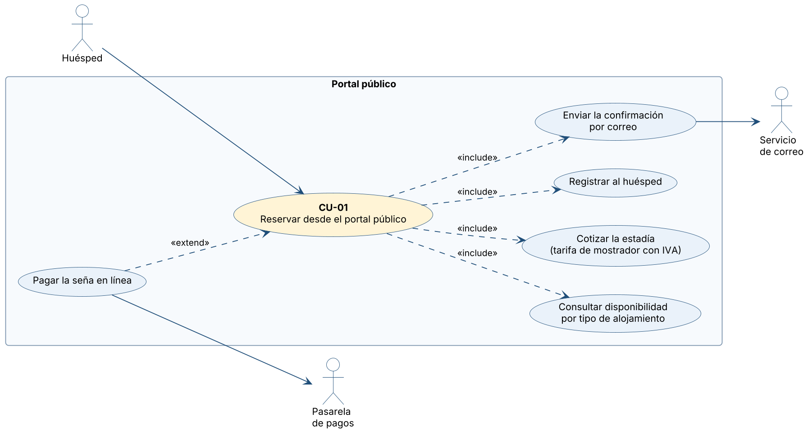

**Figura 14.** CU-01: diagrama de asociaciones (2026). Fuente: elaboración propia.

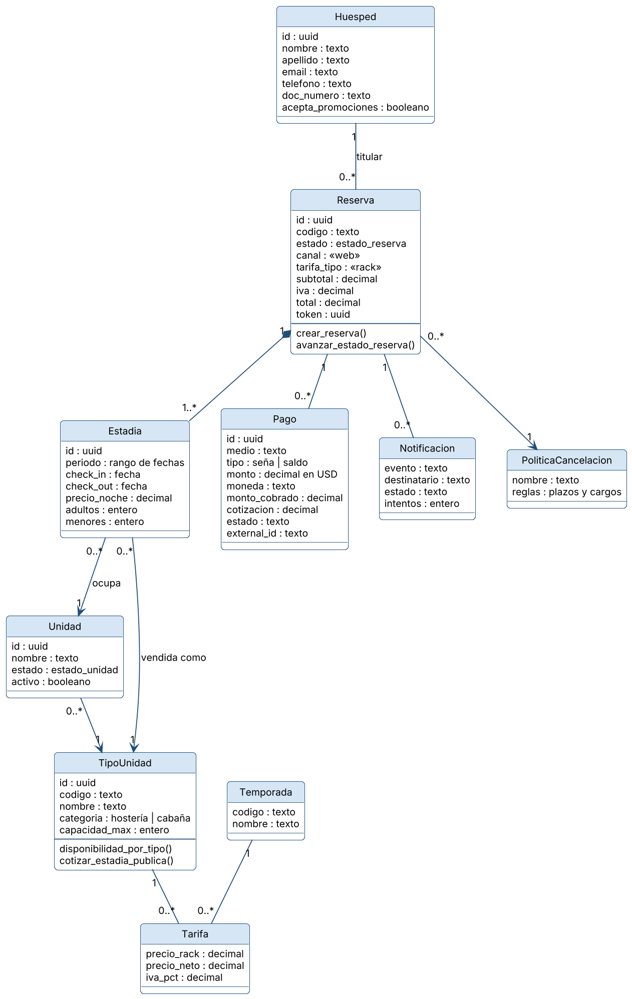

**Figura 15.** CU-01: diagrama de clases (2026). Fuente: elaboración propia.

#### Vista dinámica

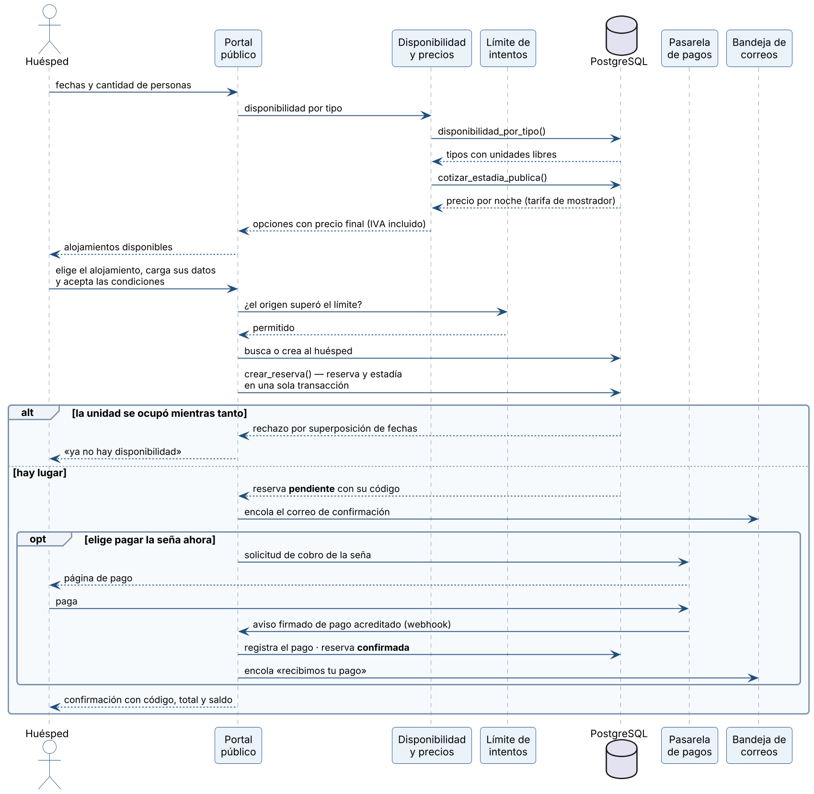

**Figura 16.** CU-01: diagrama de secuencia (2026). Fuente: elaboración propia.

### 6.3.2. Módulo Reservas y estadías — CU-02 Hacer el check-in

#### Requerimientos específicos

- RF-09, RF-10 y RF-23.
- RN-02 y RN-20.
- RNF-02, RNF-08, RNF-11 y RNF-12.
- La ficha de registro en papel se reemplaza por la ficha digital del huésped.

#### Prototipos de interfaz

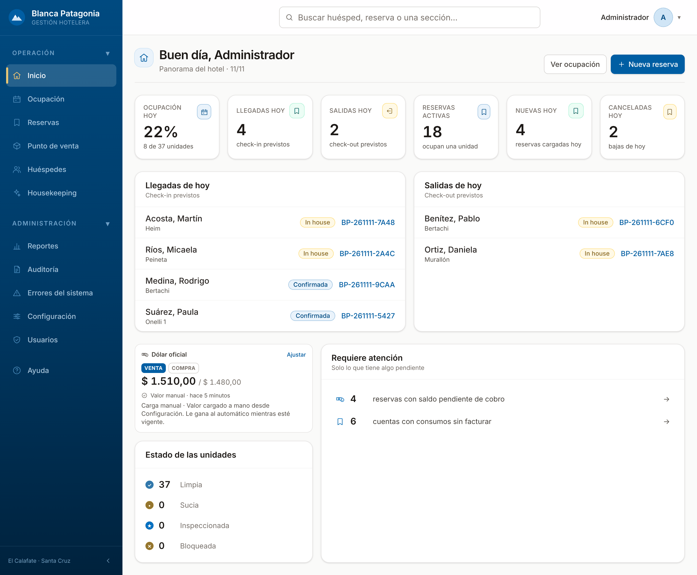

**Figura 17.** CU-02: tablero de inicio con las llegadas y salidas del día (2026). Fuente: elaboración propia, captura del sistema.

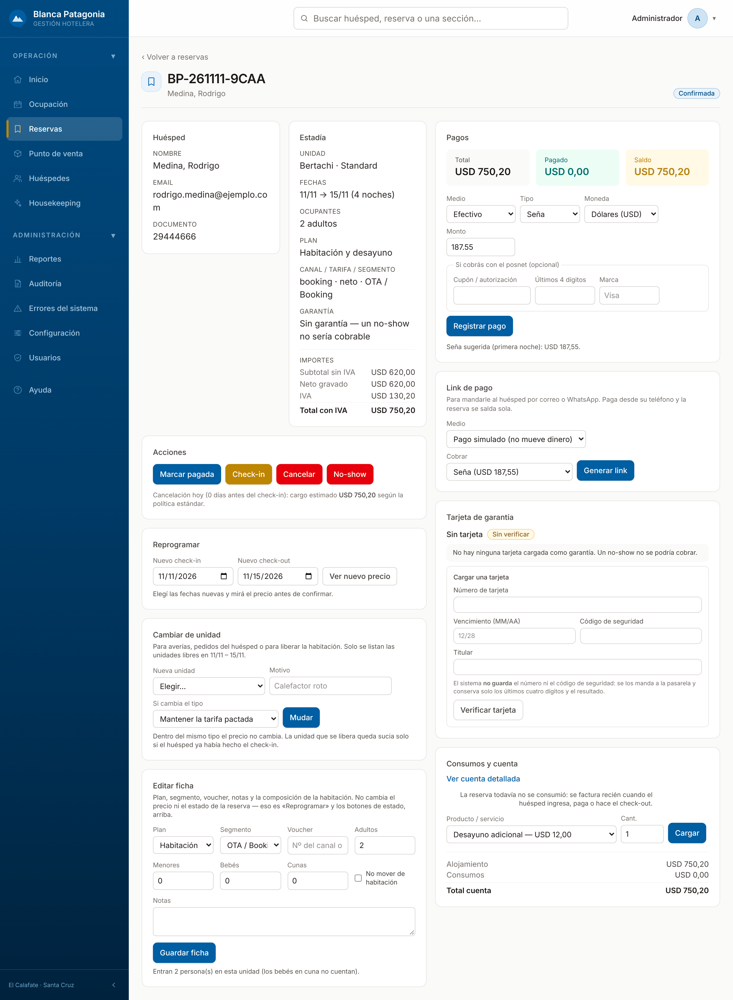

**Figura 18.** CU-02: ficha de una reserva confirmada, con la acción de check-in (2026). Fuente: elaboración propia, captura del sistema.

#### Ficha de caso de uso

| | |
|---|---|
| **Nombre** | CU-02 Hacer el check-in |
| **Módulo** | Reservas y estadías |
| **Actor principal** | Recepción |
| **Actores secundarios** | — |
| **Prioridad** | Alta |
| **Objetivo** | Registrar el ingreso del huésped y dejar la unidad como ocupada. |
| **Precondiciones** | El usuario inició sesión con un rol que accede a Reservas. Existe una reserva confirmada o pagada a nombre del huésped. |
| **Postcondiciones** | La reserva y su estadía quedan en estado alojada (*in house*). El cambio queda en la auditoría. A la cuenta de la reserva ya se le pueden cargar consumos. |

| Curso normal | Curso alternativo |
|---|---|
| 1. El recepcionista abre el inicio del panel y ve las llegadas del día. | 1.1. También puede buscar la reserva por apellido o por código en el buscador o en el listado de reservas. |
| 2. Selecciona la reserva del huésped que se presenta. | 2.1. Si el huésped no tiene reserva, se carga una reserva de mostrador marcando «check-in ahora». |
| 3. El sistema muestra la ficha: huésped, unidad, fechas, ocupantes, importes, pagos y acciones posibles. | |
| 4. El recepcionista verifica el documento del huésped y, si faltan datos, los completa en su ficha. | |
| 5. Pulsa «Check-in». | 5.1. Si la reserva está pendiente (sin seña), la acción no está disponible: primero se registra el pago y la reserva pasa a confirmada. |
| 6. El sistema comprueba que la transición esté permitida y actualiza el estado. | 6.1. Si otro puesto cambió el estado en ese instante, el sistema avisa que la reserva cambió y no aplica nada. |
| 7. El sistema muestra la reserva como alojada y la unidad figura ocupada en la grilla. Fin del caso de uso. | 7.1. Si el huésped necesita otra habitación, se usa «Cambiar de unidad» desde la misma ficha. |

#### Vista estática

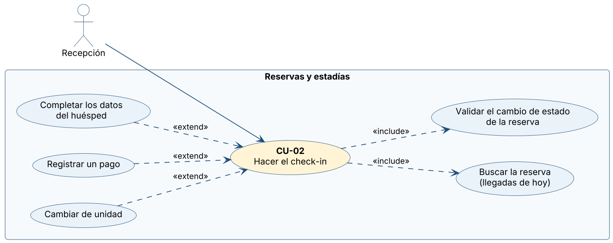

**Figura 19.** CU-02: diagrama de asociaciones (2026). Fuente: elaboración propia.

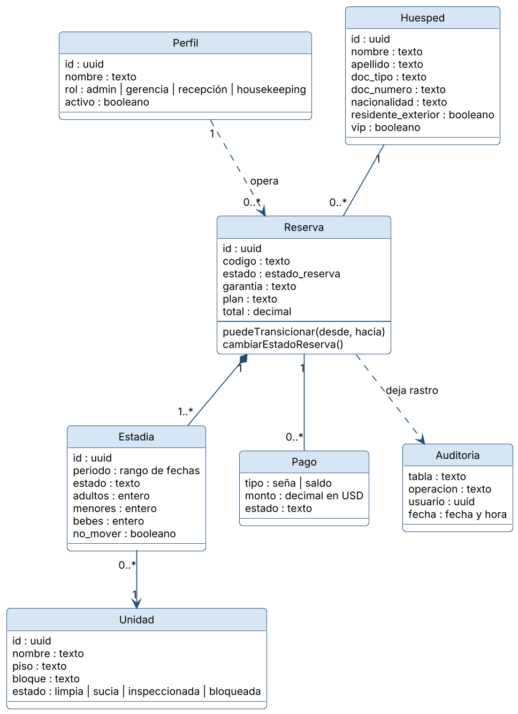

**Figura 20.** CU-02: diagrama de clases (2026). Fuente: elaboración propia.

#### Vista dinámica

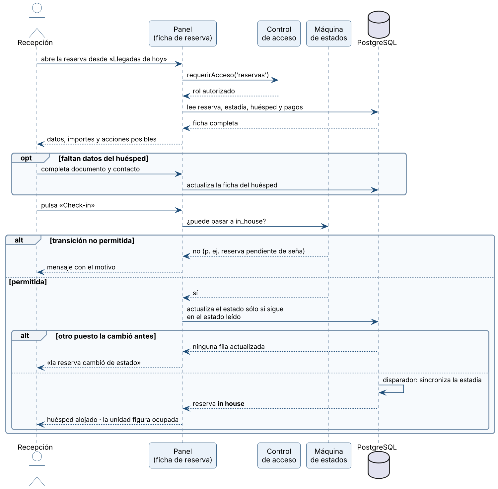

**Figura 21.** CU-02: diagrama de secuencia (2026). Fuente: elaboración propia.

### 6.3.3. Módulo Consumos — CU-03 Cargar un consumo

#### Requerimientos específicos

- RF-15, RF-16 y RF-17.
- RN-13 y RN-14.
- RNF-02, RNF-11 y RNF-12.
- Varias líneas se cargan juntas, en una comanda numerada.

#### Prototipos de interfaz

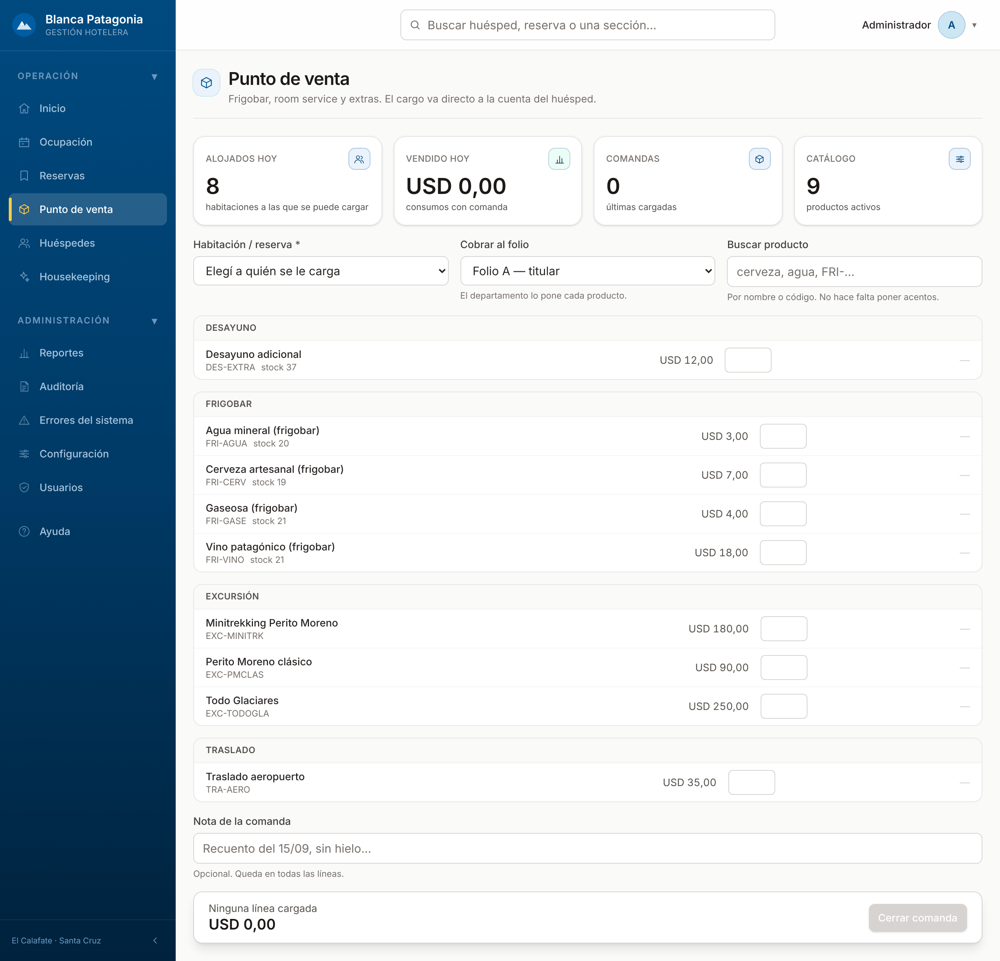

**Figura 22.** CU-03: punto de venta, con el catálogo por departamento (2026). Fuente: elaboración propia, captura del sistema.

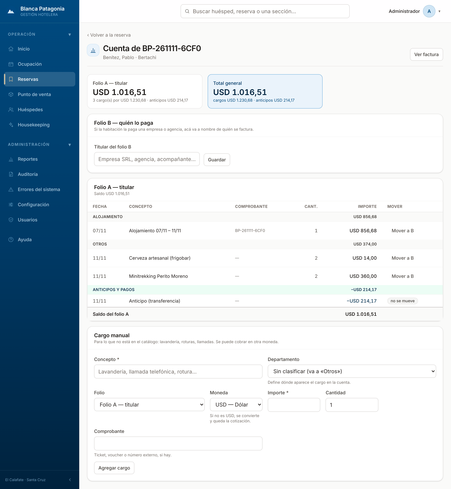

**Figura 23.** CU-03: cuenta detallada del huésped con los consumos cargados (2026). Fuente: elaboración propia, captura del sistema.

#### Ficha de caso de uso

| | |
|---|---|
| **Nombre** | CU-03 Cargar un consumo |
| **Módulo** | Consumos |
| **Actor principal** | Recepción |
| **Actores secundarios** | — |
| **Prioridad** | Alta |
| **Objetivo** | Imputar a la cuenta de un huésped alojado los productos o servicios que consumió. |
| **Precondiciones** | El usuario inició sesión con un rol que accede al Punto de venta. Hay al menos una estadía en curso. La reserva todavía no tiene factura emitida. Los productos están cargados en el catálogo. |
| **Postcondiciones** | Las líneas quedan en la cuenta de la reserva con el precio del momento, el número de comanda, el folio y el departamento. El stock de los productos que lo llevan se descontó. |

| Curso normal | Curso alternativo |
|---|---|
| 1. El recepcionista abre el Punto de venta. | |
| 2. El sistema muestra las habitaciones alojadas y el catálogo de productos agrupado por departamento, con precio y stock. | 2.1. Si no hay nadie alojado, el sistema lo informa y no permite cargar. |
| 3. El recepcionista elige la habitación y el folio (A, del titular, o B). | |
| 4. Indica la cantidad de cada producto consumido; puede buscar un producto por nombre o código y agregar una nota. | |
| 5. El sistema muestra el total de la comanda mientras se arma. | |
| 6. El recepcionista pulsa «Cerrar comanda». | 6.1. Si la reserva ya fue facturada, el sistema avisa que la cuenta está cerrada y no carga nada. |
| 7. El sistema vuelve a leer los precios del catálogo y valida la comanda. | 7.1. Si no se cargó ninguna cantidad, o una cantidad no es un número entero, el sistema lo indica. 7.2. Si de un producto queda menos stock que lo pedido, el sistema informa cuánto queda y no carga nada. |
| 8. El sistema asigna el número de comanda y registra todas las líneas en una sola operación. | |
| 9. La base descuenta el stock de cada producto. | |
| 10. El sistema confirma la carga; los consumos ya figuran en la cuenta del huésped. Fin del caso de uso. | 10.1. Si la comanda se cargó por error, puede anularse mientras la cuenta esté abierta. |

#### Vista estática

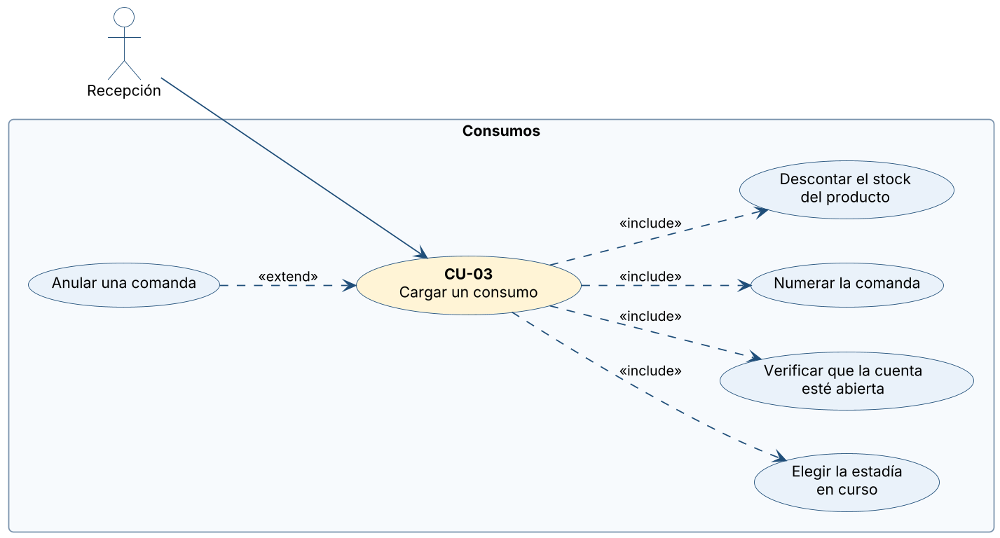

**Figura 24.** CU-03: diagrama de asociaciones (2026). Fuente: elaboración propia.

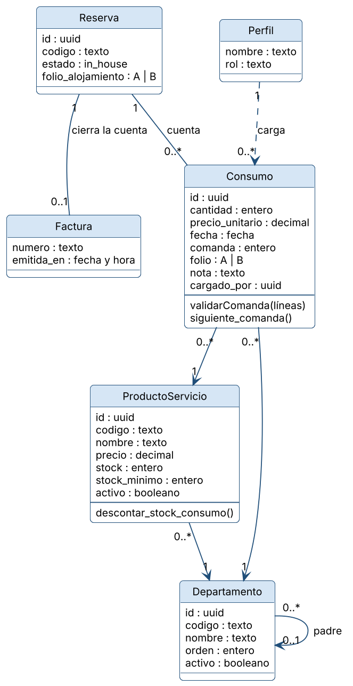

**Figura 25.** CU-03: diagrama de clases (2026). Fuente: elaboración propia.

#### Vista dinámica

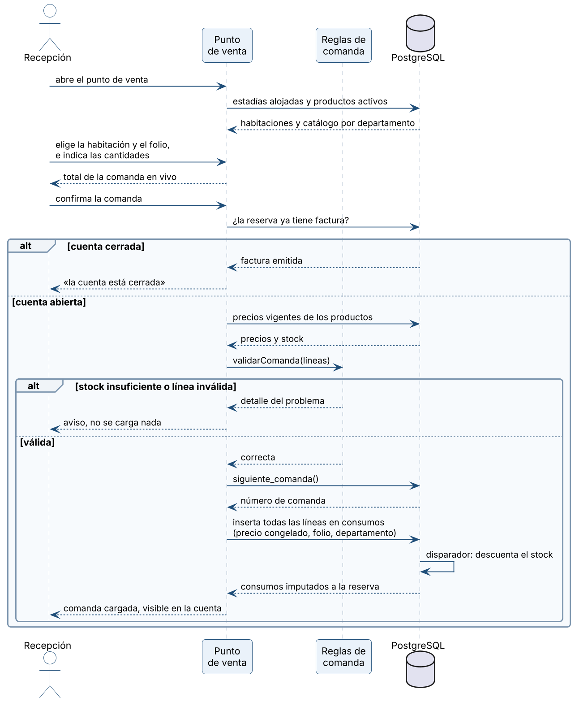

**Figura 26.** CU-03: diagrama de secuencia (2026). Fuente: elaboración propia.

### 6.3.4. Módulo Cuenta, pagos y facturación — CU-04 Hacer el check-out y emitir la factura

#### Requerimientos específicos

- RF-10, RF-18, RF-19 y RF-21.
- RN-12, RN-14, RN-15, RN-16, RN-17 y RN-18.
- RNF-08, RNF-11, RNF-12 y RNF-19.
- El total lo calcula el sistema: alojamiento más consumos, menos lo pagado.

#### Prototipos de interfaz

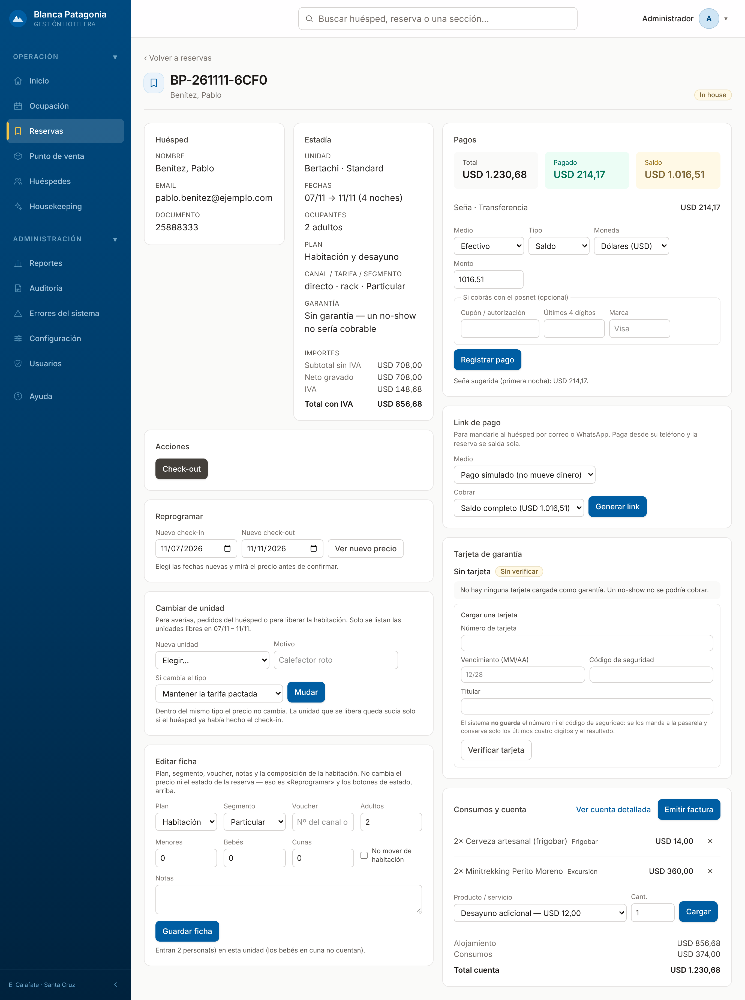

**Figura 27.** CU-04: ficha de una reserva alojada, con los pagos, la cuenta y las acciones de check-out y factura (2026). Fuente: elaboración propia, captura del sistema.

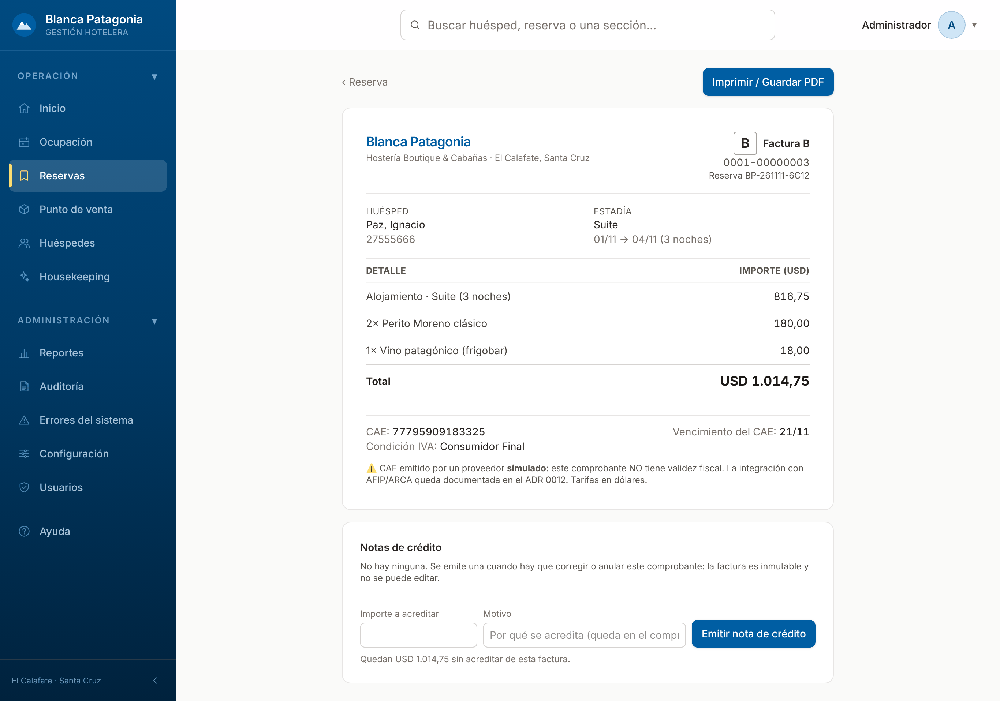

**Figura 28.** CU-04: factura emitida (2026). Fuente: elaboración propia, captura del sistema.

#### Ficha de caso de uso

| | |
|---|---|
| **Nombre** | CU-04 Hacer el check-out y emitir la factura |
| **Módulo** | Cuenta, pagos y facturación |
| **Actor principal** | Recepción |
| **Actores secundarios** | Facturación electrónica, Servicio de correo |
| **Prioridad** | Alta |
| **Objetivo** | Cerrar la estadía, cobrar el saldo y entregar al huésped el comprobante de lo consumido. |
| **Precondiciones** | El usuario inició sesión con un rol que accede a Reservas. La reserva está alojada. |
| **Postcondiciones** | La reserva queda en estado *check-out* y deja de ocupar la unidad. Queda registrada una factura con su número correlativo y su código de autorización, que no puede modificarse. La cuenta queda cerrada. Se generó la encuesta de satisfacción y el huésped sumó puntos de fidelidad. |

| Curso normal | Curso alternativo |
|---|---|
| 1. El recepcionista abre la reserva desde las salidas del día. | |
| 2. El sistema muestra la cuenta consolidada: alojamiento, consumos, pagos y saldo. | 2.1. Si falta cargar un consumo, se carga antes de continuar (CU-03). |
| 3. El recepcionista cobra el saldo y registra el pago, indicando el medio y la moneda. | 3.1. Si el huésped paga en pesos, el sistema convierte el importe a la cotización de venta del día y guarda la cotización aplicada. 3.2. Si no queda saldo, se omite este paso. |
| 4. Pulsa «Check-out» y confirma. | 4.1. Si otro puesto ya había hecho el check-out, el sistema avisa y no lo repite. |
| 5. El sistema cierra la estadía, libera la unidad y genera la encuesta de satisfacción. | |
| 6. El recepcionista pulsa «Emitir factura» y confirma. | 6.1. Si la reserva ya tenía factura, el sistema muestra la existente y no emite otra. |
| 7. El sistema determina el tipo de comprobante según la condición frente al IVA del hotel y del huésped. | 7.1. Si el huésped reside en el exterior y pagó desde el exterior, el alojamiento se factura exento de IVA y el comprobante indica el motivo. |
| 8. El sistema calcula el neto y el IVA, y reserva el número correlativo. | |
| 9. El sistema solicita el código de autorización (CAE) al servicio de facturación. | 9.1. Si el servicio no responde, el sistema lo informa y la factura no se emite; puede reintentarse sin que se pierda ni se repita el número. |
| 10. El sistema registra la factura y la muestra lista para imprimir o guardar en PDF. Fin del caso de uso. | 10.1. Si después hay que corregirla, se emite una nota de crédito. |

#### Vista estática

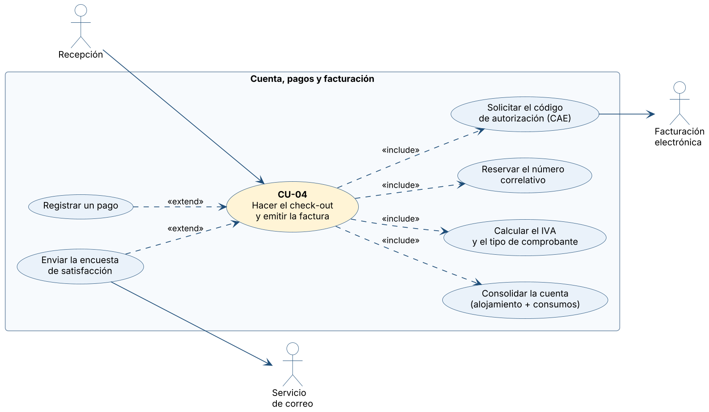

**Figura 29.** CU-04: diagrama de asociaciones (2026). Fuente: elaboración propia.

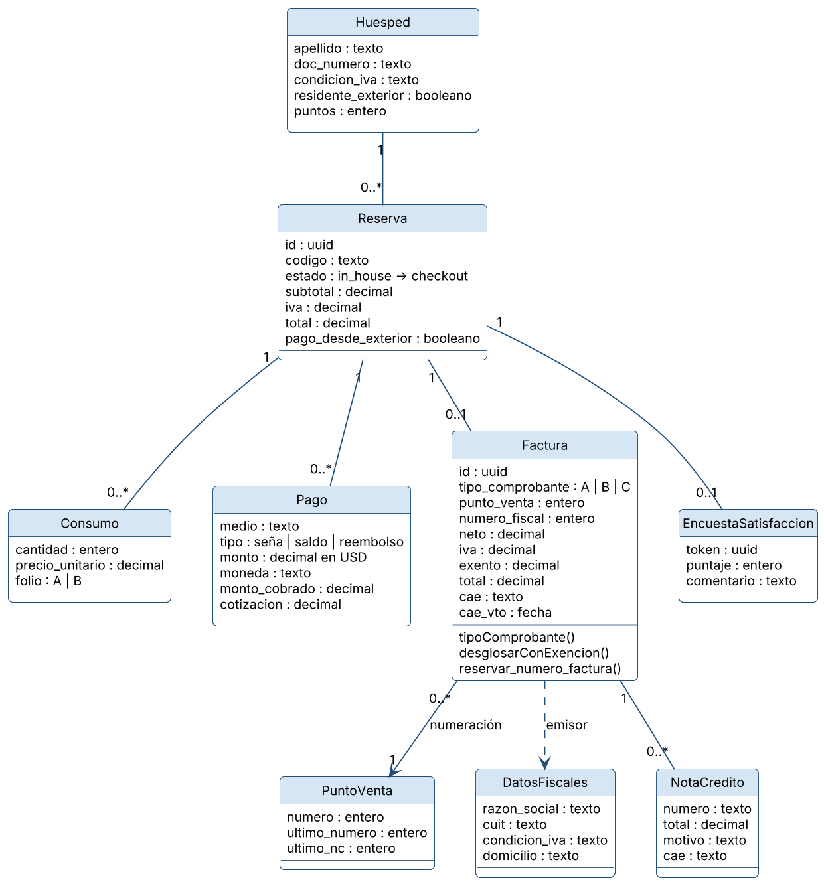

**Figura 30.** CU-04: diagrama de clases (2026). Fuente: elaboración propia.

#### Vista dinámica

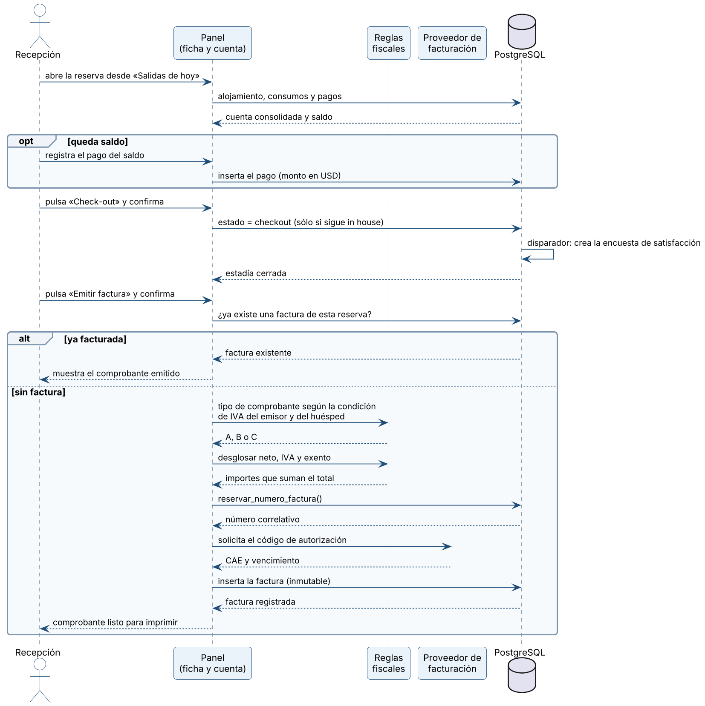

**Figura 31.** CU-04: diagrama de secuencia (2026). Fuente: elaboración propia.

### 6.3.5. Módulo Reportes — CU-05 Consultar los indicadores de gestión

#### Requerimientos específicos

- RF-29 y RF-30.
- RN-10.
- RNF-02 y RNF-11.
- Los indicadores se calculan sobre la operación registrada, con una sola definición para todo
  el sistema: **ocupación** = noches vendidas / noches disponibles; **ADR** = ingreso por
  alojamiento / noches vendidas; **RevPAR** = ingreso por alojamiento / noches disponibles.

#### Prototipos de interfaz

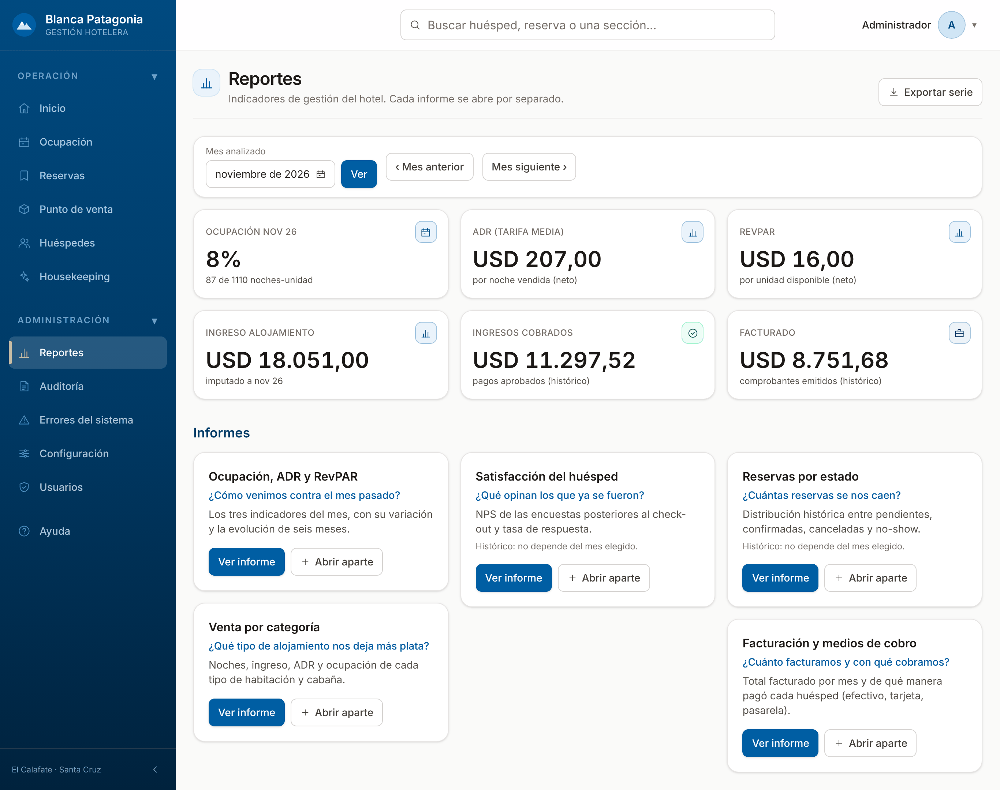

**Figura 32.** CU-05: índice de reportes (2026). Fuente: elaboración propia, captura del sistema.

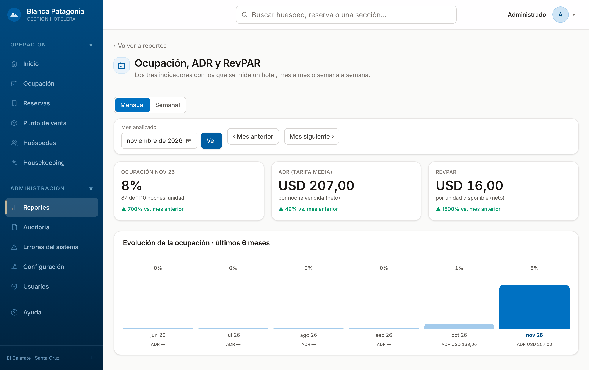

**Figura 33.** CU-05: reporte de ocupación, ADR y RevPAR (2026). Fuente: elaboración propia, captura del sistema.

#### Ficha de caso de uso

| | |
|---|---|
| **Nombre** | CU-05 Consultar los indicadores de gestión |
| **Módulo** | Reportes |
| **Actor principal** | Gerencia |
| **Actores secundarios** | Administrador |
| **Prioridad** | Media |
| **Objetivo** | Conocer la ocupación, la tarifa promedio y el ingreso por habitación disponible de un período, sin armar el informe a mano. |
| **Precondiciones** | El usuario inició sesión con rol de gerencia o de administrador. |
| **Postcondiciones** | Ninguna: es una consulta y no modifica datos. |

| Curso normal | Curso alternativo |
|---|---|
| 1. El gerente abre Reportes. | 1.1. Si el rol no tiene acceso a Reportes, la opción no aparece en el menú y, si se escribe la dirección a mano, el sistema lo lleva al inicio. |
| 2. El sistema muestra el índice de informes disponibles. | |
| 3. El gerente elige «Ocupación, ADR y RevPAR». | 3.1. Puede elegir otro informe: venta por categoría, facturación y medios de cobro, reservas por estado o satisfacción del huésped. |
| 4. El sistema lee las estadías del período y la cantidad de unidades activas y calcula los tres indicadores del mes en curso. | 4.1. Si la lectura falla, el sistema lo indica en pantalla en lugar de mostrar ceros. |
| 5. El sistema muestra cada indicador con su variación respecto del mes anterior y la evolución de los últimos seis meses. | 5.1. Si el mes anterior no tiene datos, no se muestra variación. |
| 6. El gerente cambia el mes o pasa a la vista semanal. | |
| 7. El sistema recalcula y muestra los indicadores del nuevo período. Fin del caso de uso. | 7.1. El gerente puede abrir el informe en una pantalla aparte para imprimirlo. |

#### Vista estática

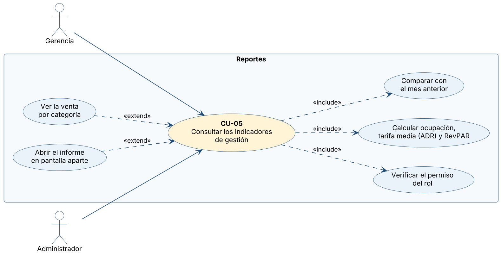

**Figura 34.** CU-05: diagrama de asociaciones (2026). Fuente: elaboración propia.

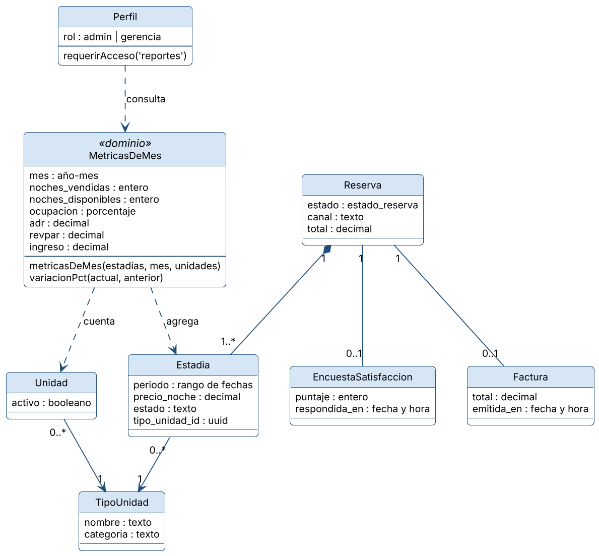

**Figura 35.** CU-05: diagrama de clases (2026). Fuente: elaboración propia.

#### Vista dinámica

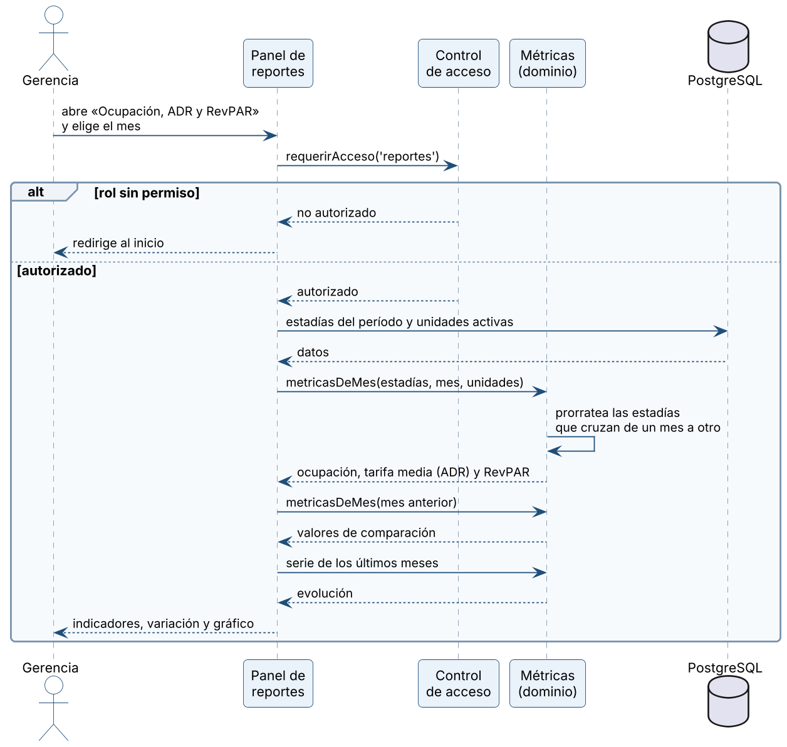

**Figura 36.** CU-05: diagrama de secuencia (2026). Fuente: elaboración propia.

## 6.4. Modelo de Datos

El sistema usa 30 tablas en una base de datos PostgreSQL. La Figura 37 muestra todas con sus
relaciones; las Figuras 38 a 40 detallan los campos por grupo.

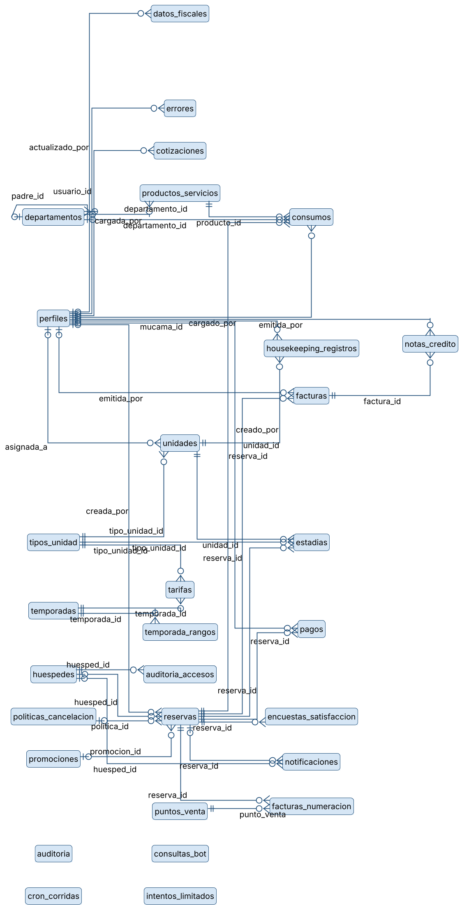

**Figura 37.** Diagrama entidad-relación: vista general de las 30 tablas (2026). Fuente: elaboración propia.

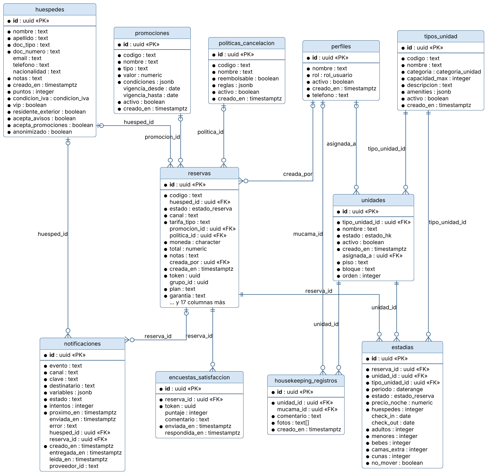

**Figura 38.** Diagrama entidad-relación: reservas, estadías y huéspedes (2026). Fuente: elaboración propia.

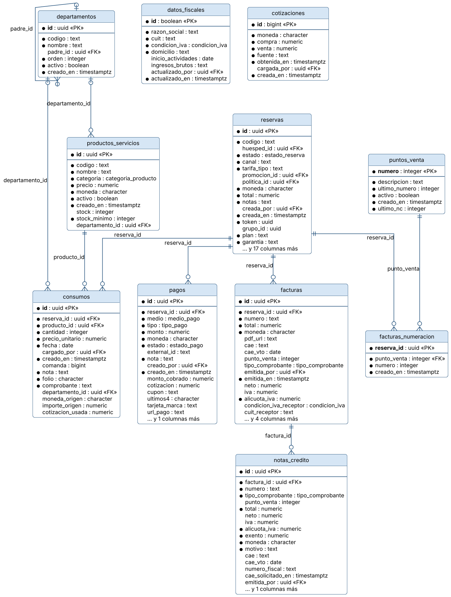

**Figura 39.** Diagrama entidad-relación: consumos, pagos y facturación (2026). Fuente: elaboración propia.

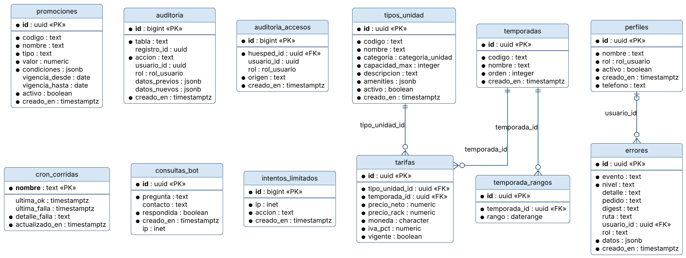

**Figura 40.** Diagrama entidad-relación: tarifario, seguridad y operación (2026). Fuente: elaboración propia.

### La decisión central: la sobreventa se impide en la base

El problema más grave del relevamiento era el riesgo de sobreventa cuando dos recepcionistas
consultaban la disponibilidad al mismo tiempo. Una verificación hecha por la aplicación no lo
resuelve: entre que se consulta y se graba puede entrar otra reserva.

Por eso la garantía está en la propia base de datos. La reserva se separa en dos tablas:
`reservas`, con los datos comerciales, y `estadias`, con la unidad y el período ocupado. Sobre
`estadias` hay una restricción de exclusión que rechaza cualquier fila cuyo período se
superponga con el de otra estadía activa de la misma unidad. Si dos operaciones intentan
ocupar la misma unidad a la vez, la base acepta la primera y rechaza la segunda, sin importar
desde dónde lleguen. El período es un rango que no incluye el día de salida, de modo que una
unidad puede recibir un ingreso el mismo día en que tuvo un egreso.

### Ciclo de vida de la reserva

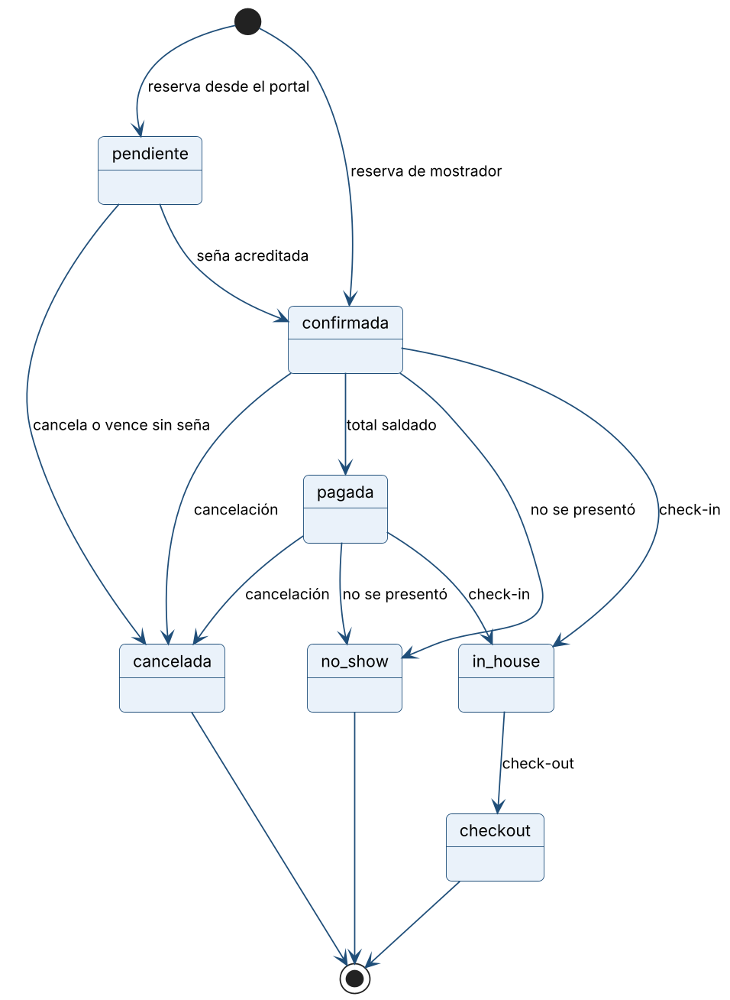

**Figura 41.** Ciclo de vida de la reserva (2026). Fuente: elaboración propia.

Una reserva solo cambia de estado por las transiciones de la Figura 41. Las reservas
pendientes, confirmadas, pagadas y alojadas ocupan la unidad; las que están en *check-out*,
canceladas o *no-show* la liberan.

### Diccionario de datos

El diccionario detalla, campo por campo, las tablas que intervienen en los casos de uso
principales y describe las restantes. Se incluye a continuación (`diccionario-de-datos.md`).
