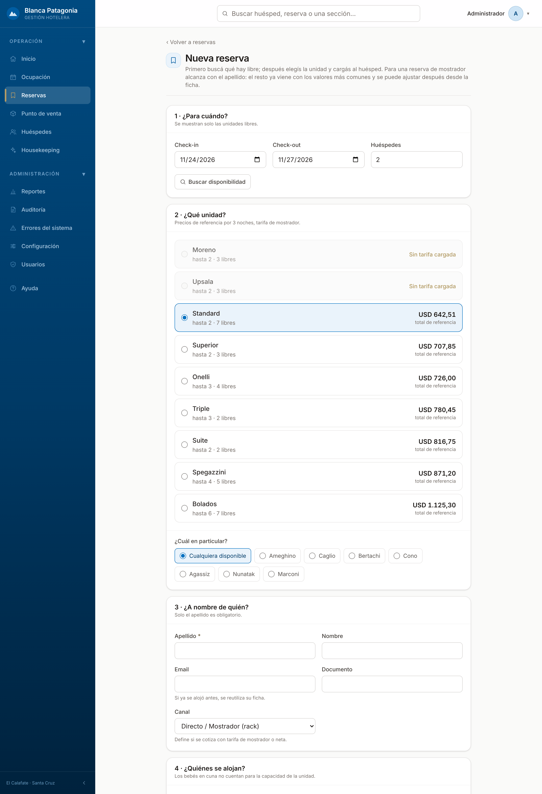
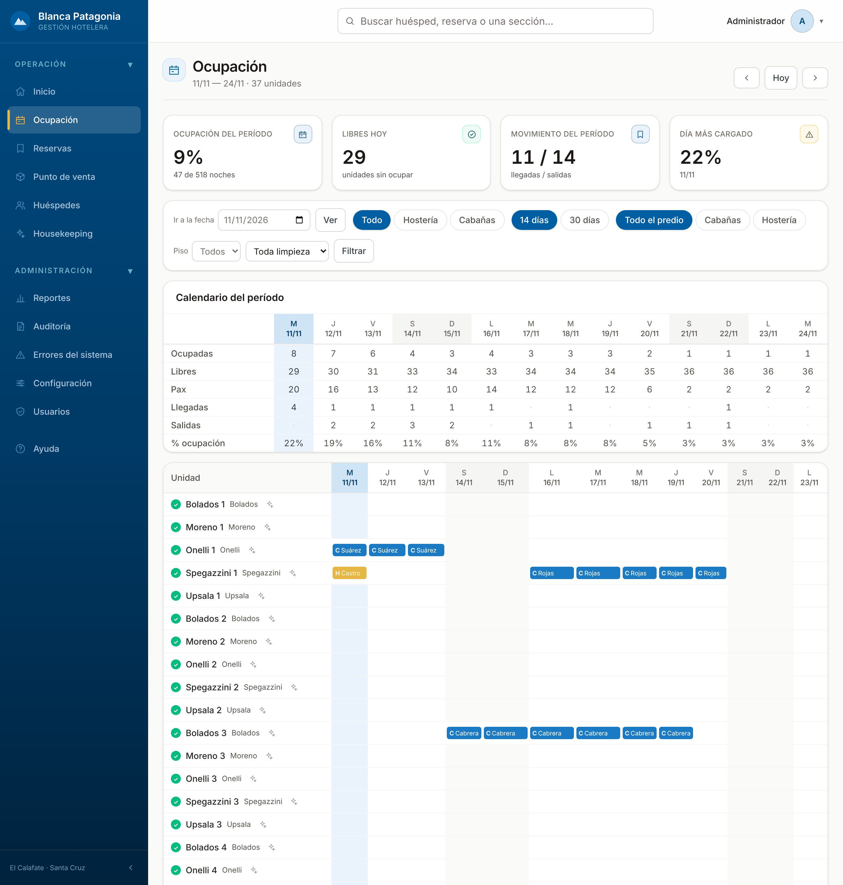
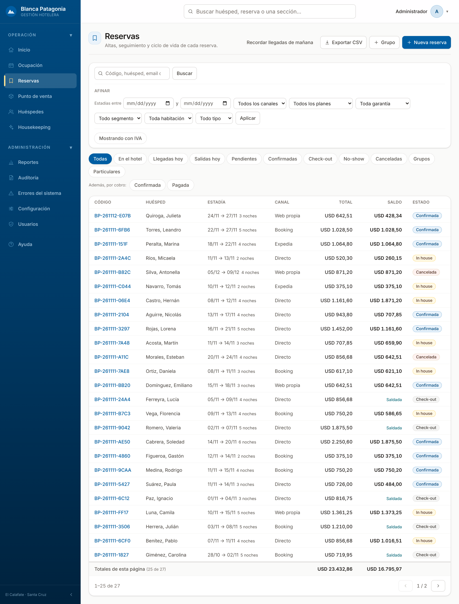
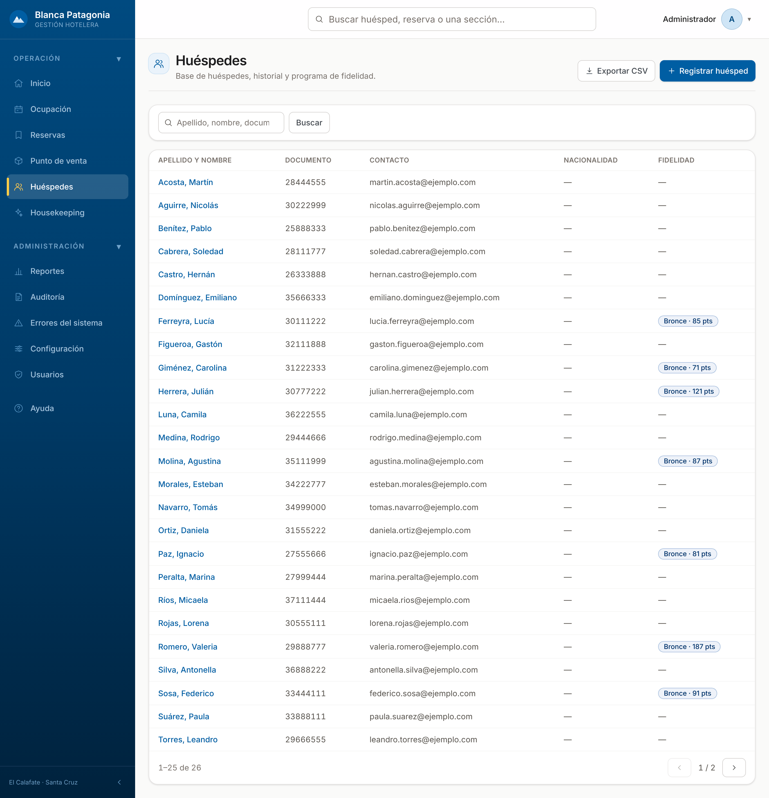
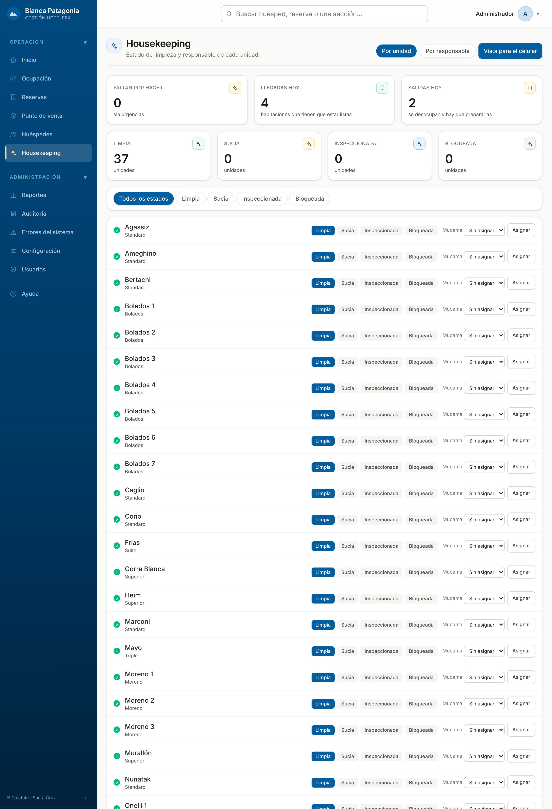
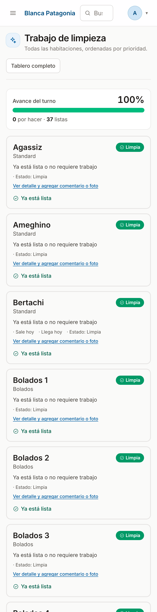
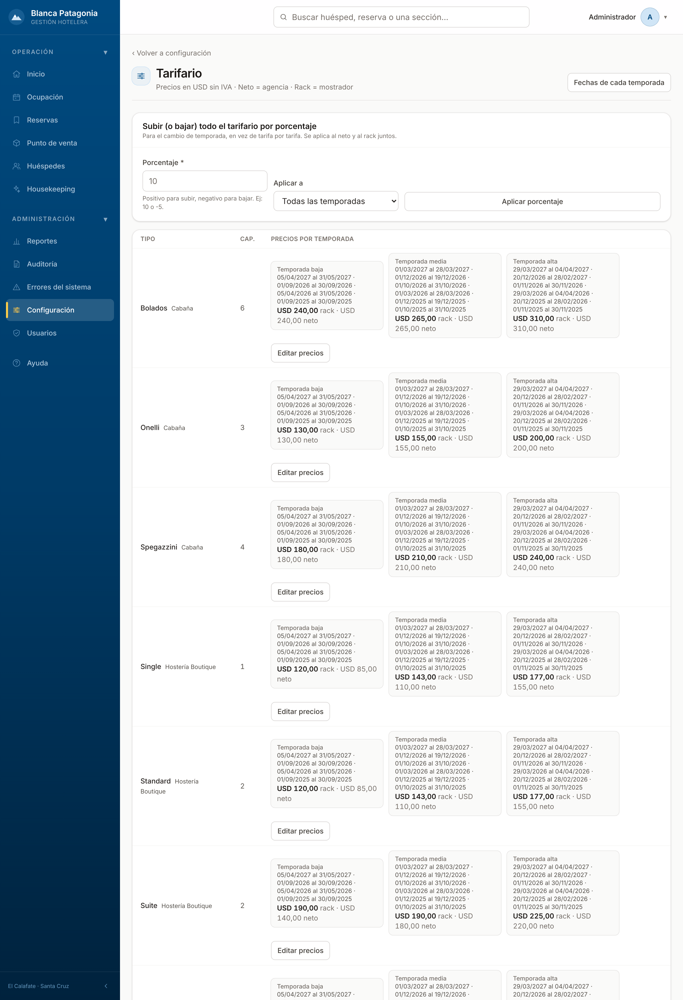
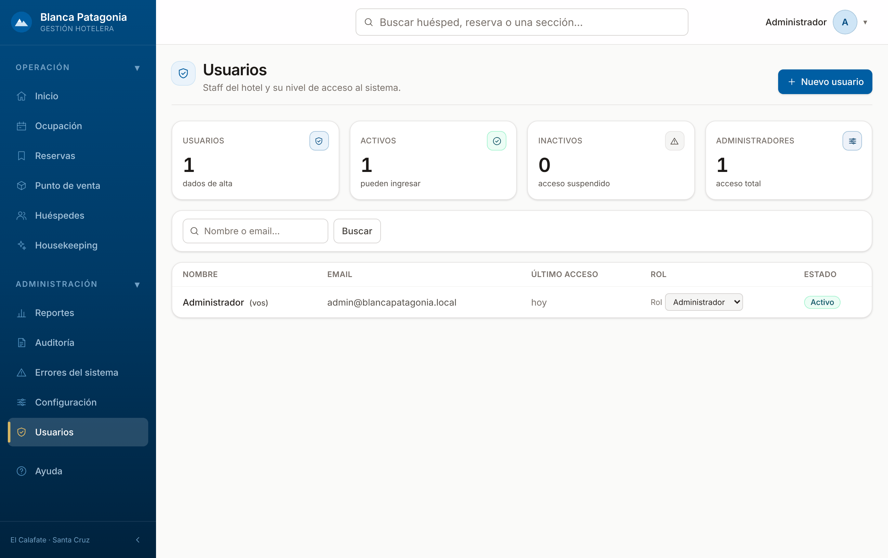
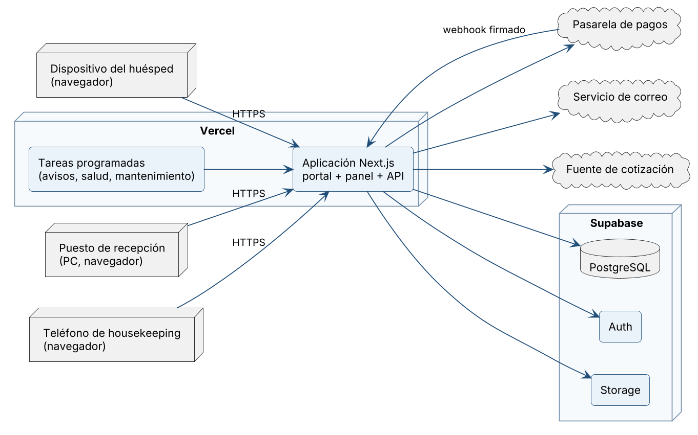
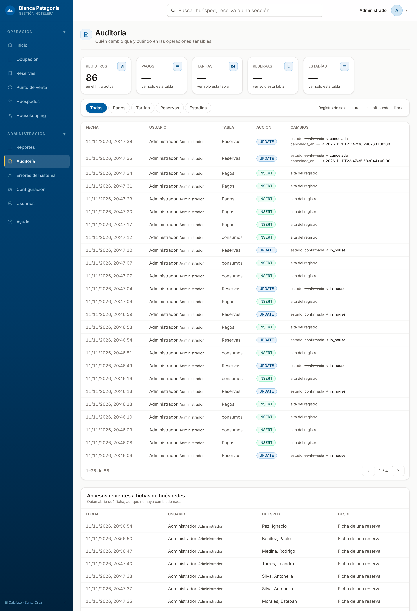

# 7. Implementación del Software

El sistema se construyó como una única aplicación web. Este capítulo describe cómo está
implementado cada módulo y, dentro de cada uno, el caso de uso principal: qué pantallas lo
componen, qué regla de negocio lo gobierna y dónde vive esa regla.

## 7.1. Criterios comunes a todos los módulos

- **Tres capas.** Las pantallas y las operaciones (carpeta `src/app`) orquestan; las reglas de
  negocio están en módulos puros (`src/lib/domain`), sin dependencia de la interfaz ni de la
  base, lo que permite probarlas de forma aislada; el acceso a los datos pasa por `src/lib/supabase`.
- **La base hace cumplir lo crítico.** La superposición de reservas, la numeración de las
  facturas, el descuento de stock, la auditoría y los permisos por rol se resuelven con
  restricciones, funciones, disparadores y políticas de PostgreSQL, de modo que valen aunque
  la operación llegue por otro camino.
- **Toda operación verifica el rol** antes de ejecutarse y **revisa el resultado** de cada
  lectura y escritura: si algo falla, el usuario lo ve en pantalla, en español.
- **Los servicios externos se usan a través de adaptadores.** Pagos, correo, facturación y
  cotización tienen cada uno una interfaz común y varias implementaciones, que se eligen por
  configuración sin tocar el resto del sistema.
- **Fechas del hotel.** «Hoy» y todas las horas se calculan en la zona horaria de El Calafate.

## 7.2. Módulo Portal público y Reservas — CU-01 Reservar desde el portal público

El portal es la parte pública de la aplicación (`src/app/(front-publico)`). La búsqueda llama
a dos funciones de la base: `disponibilidad_por_tipo`, que devuelve los tipos con unidades
libres para el período, y `cotizar_estadia_publica`, que calcula el precio noche por noche con
la tarifa de mostrador. El portal le suma el IVA antes de mostrarlo, de modo que el huésped
siempre ve el precio final.

Al confirmar, la operación `crearReservaPublica` controla el límite de intentos por origen,
busca o crea la ficha del huésped y llama a `crear_reserva`, una función de la base que
inserta la reserva y su estadía en una sola transacción. La garantía contra la sobreventa es
la restricción de exclusión sobre la tabla `estadias`:

```sql
constraint estadias_sin_solape
  exclude using gist (unidad_id with =, periodo with &&)
  where (estado in ('pendiente', 'confirmada', 'pagada', 'in_house'))
```

Si dos personas intentan tomar la misma unidad para fechas que se cruzan, la base acepta la
primera y rechaza la segunda. El sistema traduce ese rechazo en el mensaje «ya no hay
disponibilidad».

El cobro de la seña se delega en la pasarela: el sistema genera la solicitud de cobro y lleva
al huésped a la página de pago. Cuando el pago se acredita, la pasarela llama al punto de
entrada de avisos del sistema (`/api/webhooks/pagos`), que verifica la firma del aviso,
registra el pago y pasa la reserva a confirmada. La pantalla de confirmación lee el estado de
la base: abrir esa dirección a mano no confirma nada. Los correos al huésped se encolan en la
tabla `notificaciones` y los despacha una tarea programada, para que una demora del servicio
de correo no frene la reserva.

Las reservas de mostrador usan la misma función `crear_reserva` desde el panel.



**Figura 42.** Alta de reserva de mostrador: fechas, unidad, huésped y condiciones (2026). Fuente: elaboración propia, captura del sistema.



**Figura 43.** Grilla de ocupación por unidad y por día (2026). Fuente: elaboración propia, captura del sistema.



**Figura 44.** Listado de reservas con búsqueda, filtros y vistas operativas (2026). Fuente: elaboración propia, captura del sistema.

## 7.3. Módulo Reservas y estadías — CU-02 Hacer el check-in

La ficha de la reserva (`panel/reservas/[id]`) reúne al huésped, la estadía, los pagos, la
cuenta y las acciones. Los botones de acción se generan a partir de la tabla de transiciones
del dominio, por lo que la ficha solo ofrece los cambios de estado válidos:

```ts
export const TRANSICIONES: Record<EstadoReserva, readonly EstadoReserva[]> = {
  pendiente: ['confirmada', 'cancelada'],
  confirmada: ['pagada', 'in_house', 'cancelada', 'no_show'],
  pagada: ['in_house', 'cancelada', 'no_show'],
  in_house: ['checkout'],
  checkout: [],
  cancelada: [],
  no_show: [],
}
```

La operación `cambiarEstadoReserva` vuelve a validar la transición en el servidor y actualiza
la reserva con la condición de que siga en el estado que se leyó: si dos puestos pulsan
«Check-in» a la vez, el segundo no modifica nada. Un disparador de la base sincroniza el
estado de la estadía y otro deja el cambio en la auditoría.

La ficha del huésped guarda sus datos y el historial de sus estadías, y reemplaza la ficha de
registro en papel.



**Figura 45.** Listado de huéspedes (2026). Fuente: elaboración propia, captura del sistema.

## 7.4. Módulo Consumos — CU-03 Cargar un consumo

El punto de venta (`panel/punto-venta`) muestra las habitaciones alojadas y el catálogo
agrupado por departamento. Al cerrar la comanda, la operación `cerrarComanda` comprueba que
la cuenta siga abierta, vuelve a leer los precios del catálogo —no confía en los que envió la
pantalla— y valida las líneas con la regla `validarComanda`. Después pide el número de
comanda a la base e inserta todas las líneas juntas.

Cada línea guarda el precio del momento y el departamento que la vendió, de modo que un
cambio posterior en el catálogo no altera lo ya cargado. El stock lo descuenta un disparador
de la base al insertar el consumo. Una vez emitida la factura, ningún camino permite cargar,
mover o quitar consumos de esa reserva.

## 7.5. Módulo Cuenta, pagos y facturación — CU-04 Hacer el check-out y emitir la factura

La cuenta consolida el alojamiento, los consumos y los pagos. El importe de cada pago se
guarda siempre en dólares; cuando el huésped paga en pesos, se guardan además el importe
cobrado y la cotización aplicada.

El check-out usa la misma operación de cambio de estado que el check-in. Al pasar a
*check-out*, un disparador genera la encuesta de satisfacción y el sistema suma los puntos de
fidelidad del huésped.

La operación `emitirFactura` sigue estos pasos: comprueba que la reserva no tenga ya una
factura; determina la letra del comprobante con la regla `tipoComprobante`, a partir de la
condición frente al IVA del hotel y del huésped; calcula el neto, el IVA y, si corresponde,
la parte exenta; reserva el número correlativo con la función `reservar_numero_factura`;
solicita el código de autorización al proveedor de facturación; e inserta la factura. El
número queda asociado a la reserva: si la solicitud falla y se reintenta, se reutiliza el
mismo número, sin saltos ni duplicados. La tabla de facturas no admite modificaciones ni
borrados: una factura se corrige con una nota de crédito.

El proveedor de facturación es un adaptador. El sistema se entrega con el proveedor de
demostración, que devuelve un código con el formato del real y marca el comprobante como no
válido fiscalmente; el módulo que traduce el comprobante al formato del servicio de
facturación electrónica ya está implementado, y la habilitación requiere el certificado
digital del hotel.

## 7.6. Módulo Housekeeping

El tablero (`panel/housekeeping`) muestra el estado de cada unidad y permite asignar mucamas.
La vista «Trabajo de limpieza» está pensada para el teléfono: lista las unidades por
prioridad, con el motivo escrito, y cada una se cierra con un botón. Cada limpieza queda en
un registro con su comentario y, si hace falta, fotos.



**Figura 46.** Tablero de housekeeping (2026). Fuente: elaboración propia, captura del sistema.



**Figura 47.** Trabajo de limpieza en el teléfono (2026). Fuente: elaboración propia, captura del sistema.

## 7.7. Módulo Reportes — CU-05 Consultar los indicadores de gestión

Los informes (`panel/reportes`) tienen cada uno su pantalla. La de ocupación lee las estadías
del período y las unidades activas, y calcula los indicadores con la regla `metricasDeMes`,
que reparte entre los meses las estadías que cruzan de uno a otro. Como todos los informes
usan esa misma regla, la ocupación, el ADR y el RevPAR tienen una sola definición en todo el
sistema. La variación contra el mes anterior no se muestra cuando ese mes no tiene datos.

## 7.8. Módulo Administración

Desde Configuración se mantienen los tipos de alojamiento, las unidades, las temporadas, el
tarifario, las promociones, el catálogo de productos, la cotización de divisas y los datos
fiscales. Usuarios permite dar de alta al personal y asignarle un rol; Auditoría muestra
quién hizo cada operación sensible.



**Figura 48.** Tarifario por tipo de alojamiento y temporada (2026). Fuente: elaboración propia, captura del sistema.



**Figura 49.** Gestión de usuarios y roles (2026). Fuente: elaboración propia, captura del sistema.

# 8. Integración y Testing

## 8.1. Estrategia

Las pruebas son automáticas y se organizan por tipo, de lo más aislado a lo más integrado.

| Tipo | Qué verifica | Archivos |
|---|---|---|
| Dominio | Las reglas de negocio puras: precios, cancelación, estados, facturación, métricas. Sin base de datos. | 71 |
| Servicios | La lógica del servidor con sus dependencias simuladas: pasarelas, correo, cotización. | 16 |
| Acciones | Las operaciones del panel y del portal. | 10 |
| Base de datos | El comportamiento real de PostgreSQL: la restricción anti-sobreventa, los permisos por rol, las funciones y los disparadores. | 27 |
| Arquitectura | Reglas de diseño que se comprueban leyendo el código: que toda operación verifique el rol, que ninguna tabla guarde datos de tarjeta, que las capas no se mezclen. | 15 |
| Componentes | Formularios de la interfaz en un navegador simulado. | 3 |
| **Total** | | **142** |

A esto se suma un recorrido de punta a punta con un navegador real, que abre todas las
pantallas del panel.

## 8.2. Pruebas de integración

Las pruebas de base de datos corren contra una base propia y aislada, que se crea desde cero
aplicando las 127 migraciones del proyecto. Así se verifica, además de las reglas, que el
esquema se pueda reconstruir completo. Los casos centrales son:

- **Sobreventa:** se intenta crear dos estadías superpuestas sobre la misma unidad y se
  comprueba que la base rechaza la segunda.
- **Permisos por rol:** con un usuario de cada rol se comprueba, tabla por tabla, qué puede
  leer y qué no; el listado de tablas se toma de la propia base, para que una tabla nueva sin
  revisar haga fallar la prueba.
- **Borde público:** se comprueba que un visitante sin sesión no pueda leer el precio para
  agencias ni escribir en ninguna tabla.
- **Operaciones simultáneas:** dos check-out lanzados a la vez sobre la misma reserva aplican
  sus efectos una sola vez.

## 8.3. Resultados

La última ejecución completa, del 11 de noviembre de 2026, corrió los 142 archivos de prueba:
**1.788 pruebas, todas aprobadas y ninguna omitida**.

En el recorrido de pantallas se abrieron las 35 pantallas fijas del panel y 11 rutas del
portal: todas respondieron correctamente, sin errores en la consola del navegador ni enlaces
rotos. Además se ejecutaron sobre una base de demostración los cinco casos de uso principales
de punta a punta, desde la interfaz: una reserva desde el portal con el pago de la seña,
check-in, carga de consumos, registro de pagos, check-out y emisión de la factura.

## 8.4. Integración continua

Cada cambio que se sube al repositorio dispara una verificación automática que instala las
dependencias, levanta una base de datos, crea el usuario administrador y ejecuta, en este
orden: la revisión de vulnerabilidades de las dependencias, la comprobación de tipos, el
control de estilo del código, todas las pruebas y la compilación de la aplicación. Si un paso
falla, el cambio no se integra.

# 9. Especificaciones del Sistema

## 9.1. Despliegue



**Figura 50.** Diagrama de despliegue (2026). Fuente: elaboración propia.

La aplicación se publica en Vercel y la base de datos, la autenticación y los archivos en
Supabase. El huésped y el personal acceden con un navegador por HTTPS; no se instala nada en
los equipos del hotel.

**Pasos de la puesta en producción**

1. Crear el proyecto en Supabase y aplicar las migraciones del repositorio.
2. Crear el proyecto en Vercel vinculado al repositorio de GitHub.
3. Cargar las variables de entorno: la dirección y las claves de la base, la dirección
   pública del sitio y el proveedor elegido para pagos, correo, facturación y cotización, con
   sus credenciales.
4. Publicar. Vercel compila la aplicación y la deja en línea; cada versión nueva aprobada se
   publica del mismo modo.
5. Crear el primer usuario administrador y, desde el panel, dar de alta al resto del personal.
6. Verificar el punto de consulta de salud y hacer una reserva de prueba.

El sistema se niega a arrancar en producción si falta declarar alguno de los proveedores,
para que nunca quede funcionando con un simulador sin que nadie lo haya decidido.

**Tareas programadas**

| Tarea | Frecuencia | Qué hace |
|---|---|---|
| Envío de avisos | Cada 5 minutos | Despacha los correos pendientes y reintenta los que fallaron. |
| Chequeo de salud | Cada 15 minutos | Comprueba que la base responda. |
| Mantenimiento | Una vez por día | Cancela las reservas pendientes vencidas y depura el registro de errores. |

El tablero de inicio avisa a la dirección si alguna de estas tareas dejó de ejecutarse.

## 9.2. Hardware mínimo y óptimo

El sistema corre en la nube, por lo que el hotel no necesita servidores. Los requisitos se
refieren a los equipos desde los que se usa.

| Puesto | Mínimo | Óptimo |
|---|---|---|
| Recepción y administración | PC con procesador de dos núcleos, 4 GB de memoria y pantalla de 1366 × 768 | PC con procesador de cuatro núcleos, 8 GB de memoria y pantalla de 1920 × 1080 |
| Housekeeping | Teléfono con Android 10 o iOS 15 y navegador actualizado | Teléfono o tableta de gama media reciente |
| Conectividad | Conexión a internet de 10 Mbps | Fibra óptica de 50 Mbps o más, con una conexión móvil de respaldo |
| Impresión | Impresora común para la factura | Impresora láser en recepción |

Los equipos y la conexión relevados en la sección 2.4.1 cumplen el requisito mínimo.

## 9.3. Software de base y de aplicación

**Software de base**

| Componente | Versión | Uso |
|---|---|---|
| Navegador web | Chrome, Edge, Firefox o Safari, en su versión vigente | Único requisito en los equipos del hotel. |
| Node.js | 22 | Entorno de ejecución de la aplicación. |
| PostgreSQL | 17 | Motor de base de datos (administrado por Supabase). |
| Supabase | Servicio en la nube | Base de datos, autenticación y almacenamiento. |
| Vercel | Servicio en la nube | Alojamiento de la aplicación y tareas programadas. |

**Software de aplicación**

| Componente | Versión | Uso |
|---|---|---|
| Next.js | 16 | Framework de la aplicación: portal, panel y servidor. |
| React | 19 | Biblioteca de interfaz. |
| TypeScript | 5 | Lenguaje de programación. |
| Tailwind CSS | 4 | Estilos de la interfaz. |
| Cliente de Supabase | 2 | Acceso a la base y a la autenticación. |
| Zod | 4 | Validación de los datos de entrada. |
| Vitest | 4 | Pruebas automáticas. |
| Playwright | 1.56 | Recorrido de pantallas con navegador real. |
| ESLint | 9 | Control de estilo del código. |

## 9.4. Seguridad y Auditoría

### Seguridad

La seguridad se aplica en capas, de modo que una falla en una no deje los datos expuestos.

| Control | Cómo está implementado |
|---|---|
| Autenticación | El personal ingresa con correo y contraseña; el registro libre está deshabilitado y las cuentas las crea un administrador. |
| Alta sin privilegios | Un usuario nuevo nace sin rol y desactivado hasta que un administrador lo habilita. |
| Roles | Cuatro roles —administrador, gerencia, recepción y housekeeping—; cada uno accede solo a sus áreas del panel. |
| Autorización en el servidor | Cada pantalla y cada operación del panel comprueba el rol antes de ejecutarse. Una prueba automática recorre el código y falla si alguna operación no lo hace. |
| Seguridad por fila | Las 30 tablas tienen seguridad por fila activa en la base, con 55 políticas por rol: aunque alguien evite la aplicación, la base solo le entrega lo que su rol permite. |
| Borde público | Un visitante sin sesión solo lee el catálogo público; no puede leer el precio para agencias ni escribir en ninguna tabla. |
| Enlaces personales | El huésped accede a su reserva, su pago, su factura y su encuesta por una clave aleatoria que no se puede adivinar ni enumerar. |
| Límite de intentos | La reserva pública, el inicio de sesión, la recuperación de contraseña, la encuesta y el pago tienen un tope de intentos por origen. |
| Avisos de pago | Cada aviso de la pasarela se verifica por su firma; un aviso repetido se aplica una sola vez. |
| Datos de tarjetas | El sistema no almacena números de tarjeta ni códigos de seguridad: el pago se hace en la página de la pasarela. Una prueba automática impide agregar un campo para esos datos. |
| Comunicación | Todo el tráfico viaja por HTTPS, y cada respuesta lleva encabezados que impiden incrustar el sitio en otra página, limitan el uso de cámara, micrófono y ubicación y obligan al transporte seguro. |
| Claves | La clave privilegiada de la base se usa solo en el servidor y nunca llega al navegador. |
| Datos personales | La ficha de un huésped puede anonimizarse a pedido del titular; el consentimiento para promociones es explícito. |

### Auditoría

- **Operaciones sensibles.** Disparadores de la base registran en la tabla de auditoría los
  cambios de estado de las reservas, la edición de la ficha, los cambios de unidad, los
  pagos, los consumos y las modificaciones de tarifas, con el usuario, la fecha y los valores
  anteriores y nuevos. Al estar en la base, el registro se genera aunque la operación llegue
  por otro camino.
- **Consultas de datos personales.** Cada vez que un usuario abre la ficha de un huésped
  queda registrado quién la consultó y cuándo.
- **Comprobantes.** Las facturas no se modifican ni se borran; las correcciones quedan como
  notas de crédito vinculadas a la factura original.
- **Errores.** Los errores del servidor se guardan en una tabla propia y se consultan desde
  el panel, sin depender de un servicio externo.
- **Consulta.** La pantalla de Auditoría, reservada al administrador, permite revisar el
  registro.



**Figura 51.** Pantalla de auditoría (2026). Fuente: elaboración propia, captura del sistema.

# 10. Conclusión

El punto de partida fue un hotel que gestionaba sus reservas con un sistema de escritorio
heredado y planillas de cálculo, y que dependía de las agencias en línea para
dos de cada tres reservas. El relevamiento mostró que los problemas más costosos no eran de
velocidad sino de control: el riesgo de vender dos veces la misma habitación, los consumos
anotados en papel y los reportes armados a mano.

El sistema desarrollado responde a cada punto del diagnóstico. El huésped puede reservar y
pagar la seña desde el portal del hotel; recepción trabaja sobre una grilla de ocupación que
no admite superposiciones; los consumos se cargan a la cuenta en el momento; la factura sale
de la cuenta con el IVA discriminado; housekeeping ve sus tareas por prioridad; y la gerencia
consulta sus indicadores sin esperar al cierre del mes.

La decisión de diseño que más pesó fue poner las reglas críticas en la base de datos y no
solo en las pantallas. La imposibilidad de la sobreventa, la numeración de las facturas, los
permisos por rol y la auditoría están garantizados por la base, y cada uno tiene pruebas
automáticas que lo demuestran.

Para que el sistema entre en operación quedan a cargo del hotel tres gestiones que no
dependen del desarrollo: contratar la pasarela de pagos, verificar el dominio para el envío
de correo y tramitar el certificado digital para la facturación electrónica. El sistema ya
tiene preparado el lugar donde se conecta cada una.

El proyecto nos permitió aplicar de punta a punta lo aprendido en la carrera: relevar una
organización real, traducir sus problemas en requerimientos, modelar la solución y
construirla con un cliente que la esperaba.

# Agradecimientos

> **Texto de ejemplo, para editar por los autores.**

A Franco Theo Cheli y a todo el equipo del Hotel Blanca Patagonia, por abrirnos las puertas
del hotel, mostrarnos cómo trabajan y confiar en nosotros para este proyecto.

A los docentes del Colegio Universitario IES Siglo 21, por acompañarnos durante la carrera y
por las correcciones que hicieron mejor este trabajo.

A nuestras familias y amigos, por la paciencia y el apoyo de todos estos años.

*Santiago Morán y Octavio Fakiani*
